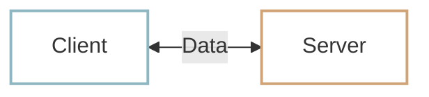
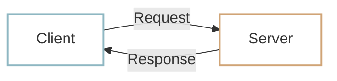

# The client-server model

Computers connected over the internet exchange data. In a web service, we distinguish between the **client** and the **server** according to the roles they play.

## Why separate the roles? {#why-separate-roles}

One important reason is to **manage data centrally**. If several computers each store and update their own copy of the same data, it becomes difficult to know which copy is current. Imagine three computers reporting the temperature in London as 20°C, 21°C, and 22°C. Which reading should you trust?

With a server managing the data in one place, the other computers can request the latest available information from it.

- A **server** serves data or functionality to other programs.
- A **client** uses that service by requesting the data or functionality it needs.

Servers often need **more storage and processing capacity** to hold data and handle many requests at once. Clients can often work with fewer resources because they use what the server provides.

!!! info "Clients and servers are programs"
    We have described them as computers to make the idea easier to picture. In practice, programs exchange the data. From here on, think of clients and servers as **programs that communicate**, rather than necessarily separate computers.

## The client {#client}

A client is a program that uses a service. When it needs data or functionality, it sends a **request** to the server.

In a web service, clients usually run on the user’s device. Examples include:

- Web browsers: Chrome, Safari, Firefox
- Mobile apps: WhatsApp, DoorDash, eBay
- Desktop apps: Slack, Notion

## The server {#server}

A server handles client requests. It finds the requested data or performs the requested operation, then sends the result back to the client. That result is called a **response**.

Production server programs usually run continuously on computers in the cloud or in data centers. Examples include:

- Web servers supporting messaging, delivery, or shopping services
- Database servers such as MySQL and PostgreSQL
- AI model servers that generate responses for services such as ChatGPT

## The client-server model {#client-server-model}

This division of responsibilities is the **client-server model**. Most web services are built around it. In the basic request-response flow, the client initiates a request and the server responds.

## :material-pencil: Exercises {#exercises}

Decide whether each statement is **True** or **False**.

1. The messaging app you see on your phone is the server.
2. A messaging service’s servers handle forwarding and storing messages.
3. A single computer can run both a client program and a server program.

??? success "Answers and explanations"
    1. **False** — The app you interact with is a client of the service.
    2. **True** — Server programs handle tasks such as forwarding and storing messages.
    3. **True** — Client and server describe program roles. Both programs can run on the same computer.
