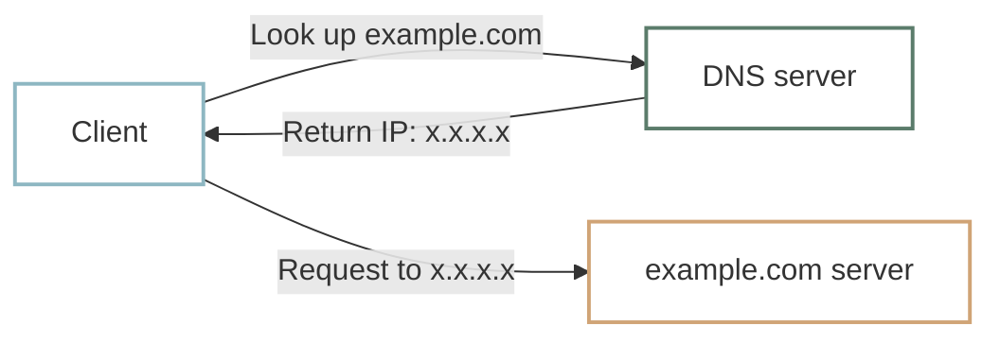

# DNS

We learned that computers use [IP addresses](ip-port.md) to communicate. Yet we have been visiting websites using names such as `example.com`. In everyday use, we type names like `wikipedia.org` or `google.com` rather than memorizing addresses like `192.0.2.1`.

## Domain names {#domain-name}

A readable internet name such as `example.com` is called a **domain name**. Numeric IP addresses work well for computers, but names are easier for people to remember.

Computers still need IP addresses to connect. **DNS (Domain Name System)** provides a way to look up addresses from domain names. Think of it like finding someone’s phone number by looking up their name in a contact list.



## Inspecting DNS resolution with curl {#inspect-dns-with-curl}

Use curl’s `-v` option to see information about resolving the domain name.

=== "macOS"

    ```shell
    curl -v https://example.com
    ```

=== "Windows PowerShell"

    ```powershell
    curl.exe -v https://example.com
    ```

Near the beginning of the output, look for lines similar to:

```text
* Host example.com:443 was resolved.
* IPv4: ...
```

`Host example.com:443 was resolved.` means curl found an address for the name. The `IPv4:` line lists the IPv4 addresses it found. Results can vary by network and over time.

## :material-pencil: Exercises {#exercises}

Decide whether each statement is **True** or **False**.

1. Domain names give people a readable alternative to remembering IP addresses.
2. DNS can look up an IP address for a domain name.
3. `was resolved` in curl’s output means the HTTP exchange has finished.

??? success "Answers and explanations"
    1. **True** — Names are easier to read and remember than numeric addresses.
    2. **True** — DNS provides name-to-address lookup.
    3. **False** — It means the address was found, before the HTTP exchange takes place.
