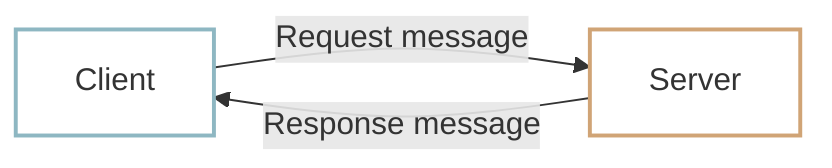

# HTTP messages

We have used browsers and curl to make HTTP requests. But what does the data exchanged between client and server actually look like? Requests and responses follow a format called an **HTTP message**. The client sends an HTTP request message, and the server returns the result in an HTTP response message.



Think of sending a letter. The envelope carries the sender’s and recipient’s addresses and postal codes, while the letter inside carries the message. The recipient checks the envelope and then reads the contents. HTTP messages work in a similar way: they include the requested action, information needed to handle the request or response, and the data being delivered.

## The structure of an HTTP message {#http-message-structure}

In the HTTP/1.1 text format we use here, requests and responses have three main parts: **a start line, headers, and an optional body**.

1. **Start line**

    The first line identifies the requested action and target path, or, in a response, the status of the result.

2. **Headers**

    These provide additional information. Request headers can identify the target server and the client. Response headers can describe the data’s format or size.

3. **Body**

    This carries the actual data, such as HTML, JSON, or an image. Some messages have no body.

## Request messages {#request-message}

The client sends an **HTTP request message** to the server. Here is a simplified request for the home page of `example.com`:

```http
GET / HTTP/1.1
Host: example.com
User-Agent: curl/8.7.1
```

1. **Start line**

    - `GET / HTTP/1.1` asks for the content at the `/` path.

2. **Headers**

    - `Host: example.com` identifies the target server.
    - `User-Agent: curl/8.7.1` identifies the client program.

3. **Body**

    - This example only requests data, so it has no request body.

!!! info "Requesting `/`"
    The `/` path usually refers to a website’s home page. A server may return an `index.html` file or generate the home page dynamically.

## Response messages {#response-message}

The server returns an **HTTP response message** after handling the request. Here is a simplified example:

```http
HTTP/1.1 200 OK
Content-Type: text/html

<!doctype html>
<html>
  <body>
    <h1>Example Domain</h1>
  </body>
</html>
```

1. **Start line**

    - `HTTP/1.1 200 OK` identifies the HTTP version and the result. `200 OK` means the request succeeded.

2. **Headers**

    - `Content-Type: text/html` says that the body contains HTML.
    - A `Content-Length` header, when present, gives the body’s size in bytes.

3. **Body**

    - `<!doctype html>...</html>` is the HTML returned by the server. A blank line separates the headers from the body.

## Inspecting HTTP messages {#inspect-http-messages}

Let’s inspect real messages with `curl`.

The earlier `curl example.com` command displayed only the response body. That is why we saw HTML but no start line or headers.

### 1. Viewing curl’s request {#curl-request-message}

The `-v` option prints detailed information about the request and response. Run:

=== "macOS"

    ```shell
    curl -v example.com
    ```

=== "Windows PowerShell"

    ```powershell
    curl.exe -v example.com
    ```

Lines beginning with `>` show the request curl sent:

```http
> GET / HTTP/1.1
> Host: example.com
> User-Agent: curl/8.7.1
```

The `>` markers are added by curl for display. They are not part of the actual HTTP message.

### 2. Viewing curl’s response {#curl-response-message}

The `-i` option includes the response’s start line and headers before the body.

=== "macOS"

    ```shell
    curl -i example.com
    ```

=== "Windows PowerShell"

    ```powershell
    curl.exe -i example.com
    ```

You should see something like this, with the HTML body following a blank line:

```http
HTTP/1.1 200 OK
Content-Type: text/html

<!doctype html>
<html>
  ...
</html>
```

### 3. Inspecting browser requests and responses {#browser-http-messages}

You can also inspect the messages your browser exchanges. These steps use Chrome.

1. Open `https://example.com`.
2. Right-click the page and select **Inspect** to open Developer Tools.

    - On Windows and Linux, you can use `F12` or `Ctrl` + `Shift` + `I`.
    - On macOS, use `Command` + `Option` + `I`.

3. Select the **Network** tab and reload the page.
4. Select `example.com` in the request list. Details appear below or beside it, depending on the window size.
5. In the **Headers** tab, inspect:

    - **General**: the request URL, method, and response status code.
    - **Request Headers**: headers sent by the browser.
    - **Response Headers**: headers returned by the server.

Select **Response** to see the response body—the HTML source we saw earlier.


!!! info "Viewing the HTML source directly"
    In Chrome, right-click a page and select **View page source** to inspect the HTML the browser received.

## :material-pencil: Exercises {#exercises}

Decide whether each statement is **True** or **False**.

1. HTTP requests and responses use a defined message format.
2. HTTP headers contain only the data being delivered.
3. Every HTTP request must have a body.

??? success "Answers and explanations"
    1. **True** — Clients and servers exchange requests and responses using HTTP messages.
    2. **False** — Headers provide information such as format, size, and destination. The body carries the content.
    3. **False** — Some requests have no body.
