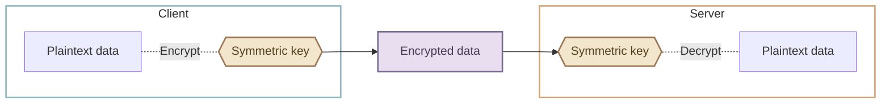
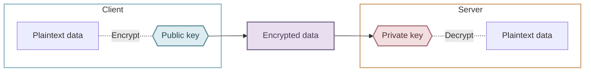

# HTTPS

We have learned how clients and servers communicate over HTTP. Most real web services use **HTTPS**. When you visit a site that still uses plain HTTP, your browser may display a “Not secure” warning. Let’s see what HTTPS adds and why it matters.

## Security problems with HTTP {#http-problems}

Plain HTTP does not encrypt data in transit. Someone who can intercept traffic along the network path may be able to read requests and responses. This is called **packet sniffing**. An attacker might also alter messages or impersonate a server in a **man-in-the-middle (MITM) attack**.

Sending sensitive data such as login credentials or payment details over plain HTTP leaves that information exposed in transit. HTTP was designed to exchange web documents; encryption is not built into the protocol itself. As the web grew to handle shopping, banking, and personal information, protecting connections became essential.

## What is HTTPS? {#what-is-https}

**HTTPS (HyperText Transfer Protocol Secure)** combines HTTP with **TLS (Transport Layer Security)**. It keeps HTTP’s basic request-response model while adding three protections.

1. **Encryption**

    Data traveling between client and server is transformed into a form that an interceptor cannot readily read.

2. **Server authentication**

    The client checks a certificate to verify that it is connecting to the server for the intended domain, reducing the risk of impersonation.

3. **Integrity protection**

    The connection detects attempts to alter messages in transit.

## Symmetric and asymmetric cryptography {#encryption-methods}

Cryptography uses keys to protect data. Two important approaches are **symmetric** and **asymmetric** cryptography.

**Symmetric encryption** uses the same secret key to encrypt and decrypt data. It is fast, so TLS uses it to protect application data such as HTTP messages. The challenge is establishing shared secret keys safely.



**Asymmetric cryptography** uses a mathematically related public and private key pair. The public key can be shared, while the owner keeps the private key secret. With a suitable public-key encryption algorithm, someone can encrypt data using a public key so that only the corresponding private key can decrypt it. Knowing the public key should not make it practical to discover the private key.



!!! info "Why does the private key remain private?"
    Generating a public key from a private key is computationally manageable, but reversing that process requires solving a difficult mathematical problem. With appropriate algorithms and key sizes, recovering the private key is not practical with current conventional computing resources.

## How HTTPS works {#how-https-works}

HTTPS combines public-key techniques with fast symmetric encryption. Before exchanging normal HTTP messages, the client and server establish a secure connection. The following is a simplified overview of a typical certificate-based TLS handshake.

1. **The browser starts a secure connection.**

    When you open an `https://` address, the browser begins negotiating a secure connection with the server before sending the normal HTTP request.

    ```mermaid
    flowchart LR
        client[Browser] -->|Request a secure connection| server[Server]

        classDef client fill:transparent,stroke:#8eb7c2,stroke-width:2px
        classDef server fill:transparent,stroke:#d0a476,stroke-width:2px
        class client client
        class server server
    ```

2. **The server sends its certificate.**

    The certificate contains information about the server’s domain and its public key.

    ```mermaid
    %%{init: {"flowchart": {"rankSpacing": 20}} }%%
    flowchart RL
        server[Server] ----> publicKey{{Public key}}
        publicKey ~~~ certificate@{ shape: doc, label: "Certificate" }
        certificate ----> client[Browser]

        classDef client fill:transparent,stroke:#8eb7c2,stroke-width:2px
        classDef server fill:transparent,stroke:#d0a476,stroke-width:2px
        classDef certificate fill:#edf0f1,stroke:#77818a,stroke-width:2px,color:#39434a
        classDef publicKey fill:#dcecf0,stroke:#5f8d9a,stroke-width:2px,color:#294650
        class client client
        class server server
        class certificate certificate
        class publicKey publicKey
    ```

3. **The browser validates the certificate.**

    It checks whether the certificate chains to a trusted **certificate authority (CA)**, whether it is valid, and whether it matches the requested domain.

    ```mermaid
    %%{init: {"flowchart": {"rankSpacing": 20}} }%%
    flowchart LR
        browser[Browser] ~~~ certificate@{ shape: doc, label: "Certificate" }
        certificate ---->|Check issuer| caList[(Trusted CAs)]

        classDef browser fill:transparent,stroke:#8eb7c2,stroke-width:2px
        classDef certificate fill:#edf0f1,stroke:#77818a,stroke-width:2px,color:#39434a
        classDef caList fill:#e7ece5,stroke:#74856f,stroke-width:2px,color:#3d4a3a
        class browser browser
        class certificate certificate
        class caList caList
    ```

    !!! info "Trusted certificate authorities"
        Browsers and operating systems maintain trusted root certificates. If the browser cannot establish a trusted certificate chain, it may show a warning such as “Your connection is not private.”

4. **The client and server establish shared secret keys.**

    They exchange key-agreement information and derive shared secrets used to create symmetric keys. Public-key authentication lets the browser verify that the server participates in this exchange legitimately. These steps form part of the **TLS handshake**.

    ```mermaid
    %%{init: {"flowchart": {"nodeSpacing": 10, "rankSpacing": 20}}}%%
    flowchart TB
        subgraph serverGroup["Server"]
            direction TB
            privateKey{{Private key}}
            serverKey{{Symmetric key}}
            serverData[Shared secret]

            privateKey ~~~ serverData
            serverData -->|Derive| serverKey
        end

        subgraph EXCHANGE[" "]
            direction LR
            X(( )) <-->|Exchange key-agreement data| Y(( ))
        end

        subgraph clientGroup["Browser"]
            direction TB

            clientKey{{Symmetric key}}
            clientData[Shared secret]
            publicKey{{Public key}}

            publicKey ~~~ clientData
            clientData -->|Derive| clientKey
        end

        style X fill:none,stroke:none
        style Y fill:none,stroke:none
        style EXCHANGE fill:none,stroke:none

        classDef publicKey fill:#dcecf0,stroke:#5f8d9a,stroke-width:2px,color:#294650
        classDef privateKey fill:#f2dedf,stroke:#a66d76,stroke-width:2px,color:#542f36
        classDef key fill:#f2e7cd,stroke:#9a7655,stroke-width:2px,color:#55401e
        classDef encrypted fill:#e8deef,stroke:#796b91,stroke-width:2px,color:#463b56
        class publicKey publicKey
        class privateKey privateKey
        class clientKey,serverKey key
        class encryptedData encrypted
        style clientGroup fill:transparent,stroke:#8eb7c2,stroke-width:2px
        style serverGroup fill:transparent,stroke:#d0a476,stroke-width:2px
    ```

    Modern TLS normally uses an ephemeral key-agreement algorithm for this exchange. The certificate’s key authenticates the server; it is not simply used to encrypt and send all the HTTP data.

5. **They exchange encrypted HTTP messages.**

    Once the secure connection is established, fast symmetric encryption protects the HTTP requests and responses.

    ```mermaid
    %%{init: {"flowchart": {"rankSpacing": 20}} }%%
    flowchart LR
        subgraph clientGroup["Browser"]
            direction TB
            clientKey{{Symmetric key}}
            clientData[Plaintext data]

            clientData -.-|Encrypt| clientKey
        end

        subgraph serverGroup["Server"]
            direction TB
            serverKey{{Symmetric key}}
            serverData[Plaintext data]

            serverKey -.-|Decrypt| serverData
        end

        clientKey --> encryptedData[Encrypted data]
        encryptedData --> serverKey

        classDef key fill:#f2e7cd,stroke:#9a7655,stroke-width:2px,color:#55401e
        classDef encrypted fill:#e8deef,stroke:#796b91,stroke-width:2px,color:#463b56
        class clientKey,serverKey key
        class encryptedData encrypted
        style clientGroup fill:transparent,stroke:#8eb7c2,stroke-width:2px
        style serverGroup fill:transparent,stroke:#d0a476,stroke-width:2px
    ```

## :material-pencil: Exercises {#exercises}

Decide whether each statement is **True** or **False**.

1. HTTPS uses an entirely different request-response model from HTTP.
2. HTTPS encrypts data in transit, making it difficult for an interceptor to read.
3. Concepts such as URLs, HTTP methods, headers, and bodies no longer apply when using HTTPS.

??? success "Answers and explanations"
    1. **False** — HTTPS adds TLS security to HTTP’s request-response model.
    2. **True** — TLS encrypts data exchanged between the client and server.
    3. **False** — These HTTP concepts still apply over HTTPS.
