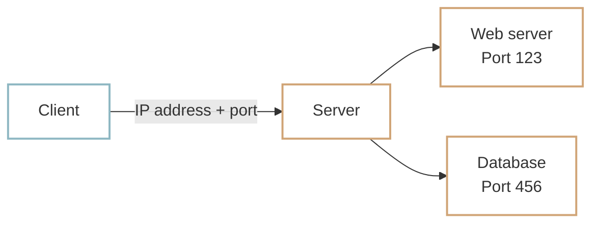

# IP addresses and ports

Computers need an addressing system to communicate. We compared [HTTP messages](http-message.md) to letters: just as a letter needs the right destination address, an internet message needs to identify where it should go.

## IP addresses {#ip-address}

An **IP (Internet Protocol) address** identifies a device or network interface so that data can be routed to it.

A familiar form is `192.168.0.1`: four numbers separated by dots, each ranging from 0 to 255. This format is called **IPv4 (IP version 4)** and has been widely used for many years.

With 256 possibilities in each position, IPv4 can represent `256 × 256 × 256 × 256`, or **4,294,967,296 addresses**—about 4.3 billion.

## Port numbers {#port-number}

Communication happens between programs, not just computers. After finding a computer by its IP address, a client still needs to identify the program it wants to reach. A **port number** helps do that.

Think of an apartment building. The street address gets you to the building, but you also need an apartment number to reach a particular resident. Similarly, one computer can run a web server, database, and mail server at the same time. Ports distinguish their network endpoints.



In this simplified picture, the IP address tells you **which computer**, and the port tells you **which program on that computer**.

!!! info "Writing port numbers"
    For an IPv4 address, put a colon (`:`) before the port. In `127.0.0.1:8000`, the IP address is `127.0.0.1` and the port is `8000`. Port numbers range from 0 to 65535. The ports in the diagram are illustrative, rather than standard web and database ports.

## Common port numbers {#common-port-numbers}

Protocols have conventional default ports. HTTP normally uses port 80, and HTTPS normally uses port 443.

| Protocol | Default port | Typical service |
| --- | ---: | --- |
| HTTP | 80 | Web server |
| HTTPS | 443 | Web server with a secure connection |

## Default ports in use {#default-port-usage}

Enter `https://example.com:443` in your browser. Once the page opens, the browser will normally omit `:443` from the address bar because it is the default HTTPS port. Entering `https://example.com` without a port still uses 443.


You can also inspect this with curl.

=== "macOS"

    ```shell
    curl -v https://example.com
    ```

=== "Windows PowerShell"

    ```powershell
    curl.exe -v https://example.com
    ```

Near the beginning of the output, look for a line similar to:

```text
* Connected to example.com (...) port 443
```

Because the address begins with `https://`, curl uses port 443 even though you did not specify a port explicitly.

## :material-pencil: Exercises {#exercises}

Decide whether each statement is **True** or **False**.

1. An IP address alone identifies a specific program running on a computer.
2. The default HTTPS port is 443.
3. A browser still uses a port when the address does not display one explicitly.

??? success "Answers and explanations"
    1. **False** — A port is also needed to reach the intended network service.
    2. **True** — HTTPS normally uses port 443.
    3. **True** — Default ports can be omitted from a URL, but they are still used for communication.
