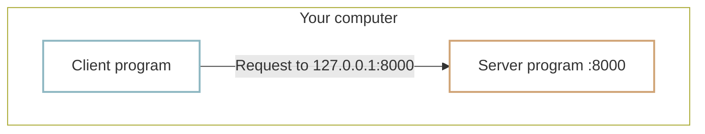

# Localhost

Some IP addresses are reserved for special purposes. If you have changed your router settings or Wi-Fi password, you may have opened an address such as `192.168.0.1` or `192.168.1.1`.

Addresses in the `192.168.x.x` range are **private IP addresses** used inside networks such as homes and offices. They do not uniquely identify a device across the entire public internet. Two different homes can each have a router at `192.168.0.1` without conflict.

Routers do not always use `192.168.x.x`. Private ranges also include `10.x.x.x` and addresses from `172.16.x.x` through `172.31.x.x`. The important point is that private addresses identify **devices within the local network you are connected to**.

## 127.0.0.1 {#localhost-address}

`127.0.0.1` is another special address: an IPv4 **loopback address**. It points back to the computer you are using. When you send a request there, it returns to your own machine rather than going to another computer.

This lets programs on one computer communicate with each other. The name **`localhost`** commonly resolves to `127.0.0.1`, or to the IPv6 loopback address `::1`. For the IPv4 examples here, we use `127.0.0.1`.

!!! info "What is a host?"
    In networking, a **host** is a computer or device participating in the network. A host can run a server that accepts requests. **Localhost** refers to your own machine, so a server reached there is running locally.

## Localhost in web development {#localhost-in-web-development}

Localhost is especially useful during development. Production clients and servers may run on separate computers, but you do not need two machines to develop a web service.

Run both programs on your computer and have the client request an address such as `http://localhost:8000`. The `8000` is the port number we discussed in [IP addresses and ports](ip-port.md), and is commonly used by development servers. You can build and inspect client-server communication on a single machine.

## :material-pencil: Exercises {#exercises}

Decide whether each statement is **True** or **False**.

1. An address starting with `192.168.x.x` uniquely identifies one computer across the entire internet.
2. `127.0.0.1` is a loopback address pointing to your own computer.
3. Localhost lets client and server programs on one computer communicate.

??? success "Answers and explanations"
    1. **False** — These private addresses can be reused in separate local networks.
    2. **True** — It is the familiar IPv4 loopback address.
    3. **True** — Programs on the same computer can communicate through loopback networking.
