# 문맥을 연결하는 트랜스포머

2017년, 구글 연구진은 현대 LLM의 발전에 중요한 전환점이 된 논문 [*Attention Is All You Need*](https://arxiv.org/pdf/1706.03762)를 발표했습니다. 이 논문에서는 새로운 신경망 구조인 **트랜스포머(Transformer)**를 제시했습니다.

트랜스포머는 기존의 신경망과 다른 방식으로 문장 속 정보를 처리하는 구조였습니다. 특히 어텐션이라는 기술을 중심에 두어, 이전까지 널리 사용되던 방식의 한계를 극복할 새로운 가능성을 보여 주었습니다. 이러한 변화는 이후 언어 모델의 규모와 성능이 크게 발전하는 중요한 기반이 되었습니다.

트랜스포머는 자연어 처리를 넘어 이미지·음성·생명과학 등 다양한 분야로 활용 범위가 확대되었습니다. 오늘날 대부분의 LLM 역시 트랜스포머 구조를 바탕으로 합니다.

## 순서대로 읽는 RNN {#rnn}

먼저 트랜스포머가 등장하기 전에는 텍스트를 분석하거나 생성하는 데 **RNN(Recurrent Neural Network)** 계열의 모델이 널리 사용되었습니다. 여기서 Recurrent는 ‘순환하는’이라는 뜻으로, 이전 단계의 정보를 다음 단계로 전달하는 구조를 가리킵니다.

RNN은 문장을 앞에서부터 단어 하나씩 순서대로 읽습니다. 이때 매 단계에서 현재 단어와 이전 단계에서 전달받은 정보를 함께 사용해 새로운 정보를 만들고, 이를 다시 다음 단계로 전달합니다. 이러한 반복적인 구조를 통해 앞에서 읽은 정보를 뒤쪽 단어를 처리할 때까지 이어갈 수 있습니다.

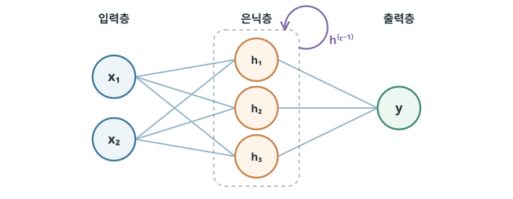{ .neural-network-image .transformer-image }

그림에서 은닉층으로 되돌아오는 화살표는 이전 단계의 은닉 상태가 다음 단계로 전달되는 과정을 나타냅니다. RNN에서는 입력을 순서대로 처리하는 각 단계를 `t`라는 시간 인덱스로 구분합니다.

각 단계에서 RNN은 현재 입력 `x⁽ᵗ⁾`와 이전 단계의 은닉 상태 `h⁽ᵗ⁻¹⁾`를 함께 사용해 현재 은닉 상태 `h⁽ᵗ⁾`를 계산합니다. `h⁽ᵗ⁾`에는 지금까지 읽은 입력을 요약한 정보가 담기고, 이 값이 다시 다음 단계로 전달됩니다. 

이 과정은 입력된 토큰의 수만큼 반복됩니다. 실제 모델은 토큰 단위로 처리하지만, 이해를 위해 문장을 단어 단위로 나누어 생각해 봅시다. 

예를 들어 “나는 커피를 마신다”라는 문장을 RNN이 어떻게 처리하는지 살펴보겠습니다. 이 문장은 세 단어로 이루어져 있으므로, RNN은 각 단어를 차례로 입력받아 은닉 상태를 갱신하는 계산을 세 번 수행합니다. 앞서 살펴본 순환 구조를 시간 단계에 따라 펼치면 다음과 같습니다.

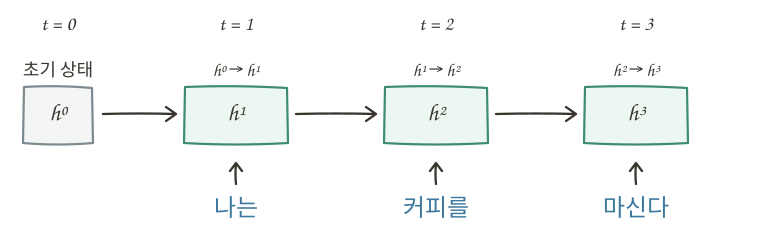{ .neural-network-image .transformer-image }

RNN은 특히 기계 번역에 많이 활용되었습니다. 이때는 보통 두 개의 RNN을 사용합니다. **인코더(encoder)**는 입력 문장을 순서대로 읽으며, 각 단계에서 지금까지 읽은 내용을 은닉 상태에 계속 반영합니다. 문장을 모두 읽고 나면 마지막 은닉 상태가 문장 전체의 정보를 요약한 **문맥 벡터(context vector)**가 됩니다. 그리고 **디코더(decoder)**는 이 문맥 벡터를 바탕으로 앞서 생성한 단어를 참고하면서 번역 문장의 다음 단어를 하나씩 예측하고 출력합니다.

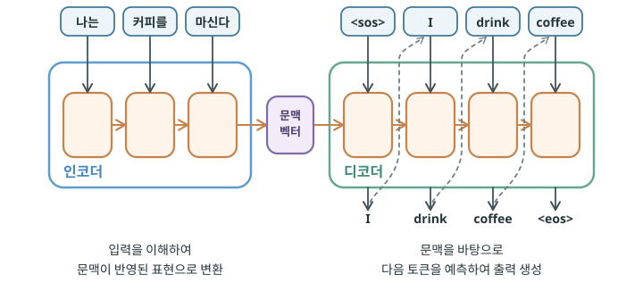{ .neural-network-image .transformer-image }

예를 들어 한국어 문장을 읽은 뒤 영어 문장으로 번역하는 과정을 살펴보겠습니다. 

위 도식에서 `<sos>`(Start of Sequence)와 `<eos>`(End of Sequence)는 각각 문장의 시작과 끝을 나타내는 특수 토큰입니다. 디코더 위의 토큰은 해당 단계에서 다음 토큰을 예측하기 위해 사용하는 입력이고, 아래의 토큰은 그 결과로 예측한 출력입니다.

인코더가 만든 문맥 벡터에는 입력 문장 전체를 요약한 정보가 담겨 있습니다. 디코더는 이 문맥 벡터와 `<sos>` 토큰을 바탕으로 첫 번째 토큰을 예측합니다. 

예를 들어 “나는 커피를 마신다”라는 문장을 영어로 번역한다면, 디코더는 입력 문장의 정보가 담긴 문맥 벡터를 바탕으로 먼저 “I”를 예측합니다. 이어서 “I”를 다음 단계의 입력으로 사용해 “drink”를 예측하고, 다시 “drink”를 입력받아 “coffee”를 예측합니다. 이 과정에서도 문맥 벡터의 정보를 활용하며, 마지막으로 문장의 끝을 나타내는 `<eos>` 토큰을 예측하면 번역이 종료됩니다.

이처럼 RNN 기반의 인코더와 디코더는 정보를 순차적으로 처리하며, 입력 문장의 문맥을 반영해 번역 문장을 생성합니다.

## RNN의 한계 {#rnn-limitations}

그런데 RNN에는 다음과 같은 중요한 한계가 있습니다.

첫 번째는 **장기 의존성(long-term dependency)** 문제입니다. RNN은 이전 은닉 상태를 다음 단계로 반복해서 전달하는 구조이기 때문에 문장이 길어질수록 앞쪽 정보가 점차 희석되거나 잊힐 수 있습니다. 그래서 멀리 떨어진 단어 사이의 관계나 긴 문맥을 충분히 반영하기 어렵습니다.

두 번째는 **벡터 병목(vector bottleneck)** 문제입니다. 초기 RNN 기반 인코더-디코더 구조에서는 인코더가 입력 문장 전체의 정보를 하나의 고정된 크기의 문맥 벡터로 압축해 디코더에 전달합니다. 문장이 길어질수록 하나의 벡터에 담아야 할 정보가 많아지면서, 번역에 필요한 단어나 단어 사이의 관계와 같은 세부 정보가 충분히 보존되지 못할 수 있습니다. 그러면 디코더는 필요한 정보를 충분히 활용하지 못한 채 다음 단어를 예측하게 됩니다.

마지막은 **병렬 처리의 어려움**입니다. RNN은 이전 단계의 은닉 상태가 계산되어야 다음 단계로 넘어갈 수 있기 때문에 한 문장 안의 여러 단어를 동시에 처리하기 어렵습니다. 그래서 긴 문장일수록 계산이 차례차례 이어지고 학습 속도도 느려집니다. 대규모 텍스트 데이터를 반복해서 학습해야 하는 경우, 이러한 순차적 처리 방식은 전체 학습 시간과 비용을 크게 늘리는 요인이 됩니다.

## Attention Is All You Need {#attention-is-all-you-need}

이러한 RNN의 한계를 극복하기 위한 새로운 접근이 앞서 소개한 *Attention Is All You Need* 논문에서 제시되었습니다.

한 가지 짚고 넘어갈 점이 있습니다. 제목 때문에 이 논문이 어텐션(attention)이라는 개념을 처음 제안했다고 생각하기 쉽지만, 그렇지 않습니다. 앞서 2014년 바다나우(Dzmitry Bahdanau)와 동료 연구자들은 [*Neural Machine Translation by Jointly Learning to Align and Translate*](https://arxiv.org/pdf/1409.0473) 논문에서 신경망 기계 번역에 어텐션을 적용하는 방식을 제안했습니다.

*Attention Is All You Need*라는 제목은 어텐션을 처음 제안했다는 의미가 아니라, RNN의 순환 구조 없이도 어텐션을 중심으로 모델을 구성할 수 있다는 점을 강조한 표현입니다. 이 논문의 핵심적인 기여는 **기존의 순환 구조를 제거하고 어텐션을 중심으로 신경망을 구성한 트랜스포머(Transformer) 구조를 제안**했다는 데 있습니다.

### Attention {#attention}

트랜스포머를 이해하기 위해 먼저 어텐션에 대해 알아보겠습니다. 어텐션은 ‘주목’ 또는 ‘집중’이라는 뜻입니다. 이름 그대로 **여러 정보 중 현재 필요한 정보가 무엇인지 중요도를 계산하고, 중요한 정보에 더 집중하는 메커니즘**입니다.

어텐션을 제안한 바다나우는 자신이 영어를 배우던 경험에서 아이디어를 떠올렸다고 합니다. 외국어 문장을 이해하거나 번역할 때, 문장 전체를 한꺼번에 처리하기보다 그 순간의 해석에 필요한 단어에 집중한다는 점에서 착안한 것입니다.

기존 RNN 번역 모델은 입력 문장 전체를 하나의 고정된 문맥 벡터에 압축해야 했습니다. 반면 어텐션을 적용하면 디코더는 **출력할 단어마다 인코더의 여러 은닉 상태를 서로 다른 비중으로 참고해**, 지금 필요한 정보에 더 집중할 수 있습니다.

번역할 문장은 앞과 같습니다. 달라진 것은 디코더가 입력 정보를 참고하는 방식입니다. 이제 어텐션이 적용된 번역 과정을 자세히 살펴보겠습니다.

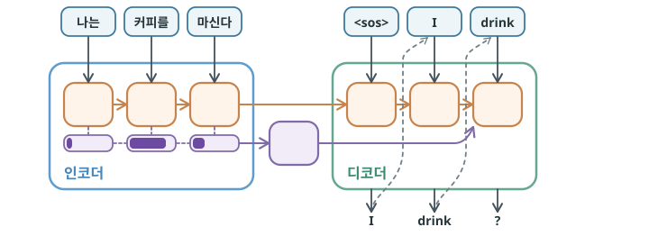{ .neural-network-image .transformer-image }

위 그림은 디코더가 다음 단어로 “coffee”를 예측하는 순간을 나타냅니다. 이때 디코더는 입력 문장을 올바르게 번역하기 위해 “나는”, “커피를”, “마신다”에 대응하는 인코더의 은닉 상태를 모두 참고하여, 현재 번역에 어떤 정보가 더 중요한지 계산합니다.

이를 위해 디코더의 현재 은닉 상태와 인코더의 각 은닉 상태가 얼마나 관련 있는지 점수로 계산하고, 이 점수를 합이 `1`인 가중치로 변환합니다. 도식에서 각 은닉 상태 아래 블록에 진한 보라색으로 표시된 정도가 바로 각 단어의 정보를 얼마나 중요하게 참고할지를 나타내는 **어텐션 가중치(attention weight)**입니다.

예를 들어 세 입력에 대한 어텐션 가중치가 각각 `0.1`, `0.7`, `0.2`로 계산되었다고 해 봅시다. “커피를”에 가장 큰 가중치가 매겨졌으므로, 이 단계에서는 “커피를”의 정보가 가장 크게 반영됩니다. 각 은닉 상태에 해당 가중치를 곱한 뒤 모두 더하면, 현재 단계에서 필요한 정보가 반영된 새로운 문맥 벡터가 만들어집니다.

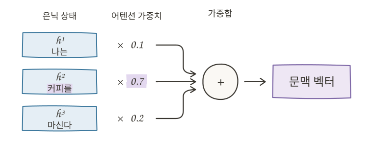{ .neural-network-image .transformer-image }

### Self-Attention {#self-attention}

어텐션은 하나의 문맥 벡터에 모든 정보를 압축하면서 발생하던 벡터 병목 문제를 완화했습니다. 하지만 인코더 자체는 여전히 RNN이므로 입력 토큰을 앞에서부터 순서대로 읽으며 은닉 상태를 계산해야 했습니다. 따라서 병렬 처리가 어렵고, 멀리 떨어진 단어 사이의 관계를 학습하기 어렵다는 한계도 남아 있었습니다.

*Attention Is All You Need* 논문은 여기서 한 걸음 더 나아갔습니다. 마치 우리가 글을 읽을 때 앞뒤 단어와 문장의 관계를 함께 살펴보듯, 단어들이 서로를 직접 참고하도록 하면 어떨까요? 이러한 발상에서 출발해 RNN의 순환 구조를 없애고, 어텐션을 중심으로 정보를 처리하는 새로운 신경망 구조인 트랜스포머가 등장했습니다.

트랜스포머에서는 문장의 각 토큰이 다른 토큰들을 직접 참고하면서 문맥이 반영된 새로운 벡터를 만듭니다. 이처럼 자기 자신을 포함한 문장 내부의 토큰들에 어텐션을 적용하는 방식을 **셀프 어텐션(self-attention)**이라고 합니다.

셀프 어텐션의 핵심은 문장 안의 각 토큰이 다른 토큰들과의 관련도를 계산하고, **관련이 높은 토큰의 정보를 더 많이 반영해 새로운 표현을 만드는 것**입니다. 토큰 사이의 거리에 관계없이 서로 직접 정보를 참고할 수 있기 때문에 멀리 떨어진 토큰 사이의 관계도 효과적으로 학습할 수 있습니다. 또한 문맥을 반영한 벡터를 만들기 위해 토큰을 순서대로 처리할 필요가 없어, 여러 토큰의 벡터를 병렬로 계산할 수 있다는 장점도 있습니다.

### Q·K·V {#query-key-value}

셀프 어텐션이 실제로 어떻게 작동하는지 이해하려면 **Q·K·V(Query, Key, Value)**라는 핵심 개념을 알아야 합니다.

같은 토큰이라도 주변에 어떤 토큰이 있는지에 따라 의미가 달라질 수 있습니다. 따라서 각 토큰의 의미를 문맥에 맞게 파악하려면 다른 토큰의 정보도 함께 고려해야 합니다. 예를 들어 “은행에서 돈을 찾았다”와 “은행을 구워 먹었다”에서 ‘은행’은 같은 단어지만, 주변 단어에 따라 각각 금융기관과 나무의 열매라는 다른 의미를 가집니다.

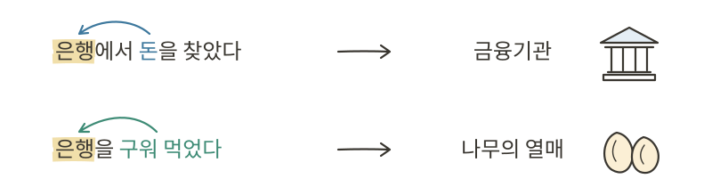{ .neural-network-image .transformer-image }

셀프 어텐션은 이를 위해 각 토큰이 다른 토큰과 어떤 관계를 가지는지 계산하고, 문맥이 반영된 새로운 벡터를 만듭니다. 쉽게 말해 **어떤 토큰의 정보를 얼마나 참고할지 결정하고, 그 정보를 모으는 과정**입니다. 이를 위해 각 토큰의 벡터를 Query, Key, Value라는 세 가지 역할의 벡터로 변환해 사용합니다.

Query, Key, Value는 각각 다음과 같은 역할을 합니다.

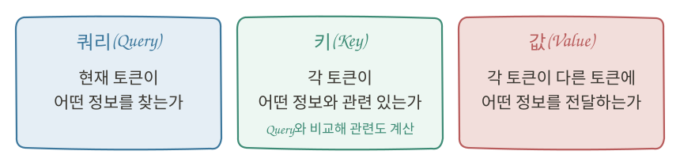{ .neural-network-image .transformer-image }

이 세 벡터는 셀프 어텐션에 입력된 토큰 벡터에 가중치 행렬 <code>WQ</code>, <code>WK</code>, <code>WV</code>를 각각 곱해 만듭니다. 즉, 하나의 토큰이 Query, Key, Value의 역할을 모두 수행하되, **각 역할에 서로 다른 벡터를 사용**하는 것입니다. 학습 과정에서 이 가중치들은 어떤 정보를 찾고, 비교하고, 전달할지에 맞게 조정됩니다.

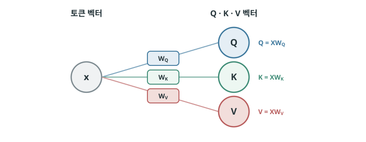{ .neural-network-image .transformer-image }

구체적으로 이 벡터들은 어떻게 사용될까요? 먼저 각 토큰의 `Q`를 문장 내 모든 토큰의 `K`와 비교해 현재 토큰과 다른 토큰이 얼마나 관련 있는지를 나타내는 점수를 계산합니다. 이때 `Q`와 `K`를 [내적](05-high-dimensional-learning.md#learning-and-vectors)하여 점수를 구하고, 점수가 지나치게 커지는 것을 완화하기 위해 `K` 벡터의 차원인 `dₖ`의 제곱근으로 나눕니다. 그리고 여기에 [소프트맥스](07-probabilistic-language-modeling.md#context)를 적용해 모든 값의 합이 `1`이 되도록 변환합니다. 이렇게 얻은 값이 각 토큰을 얼마나 참고할지를 나타내는 어텐션 가중치입니다.

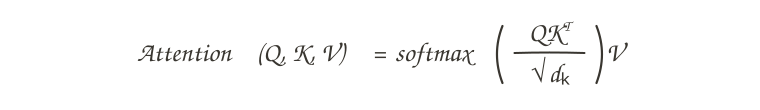{ .neural-network-image .transformer-image }

여기서 `QKᵀ`의 위 첨자 `T`는 `K` 행렬의 행과 열을 바꾸는 전치(transpose)를 뜻합니다. 이렇게 전치된 `K`와 `Q`를 곱하면 각 토큰의 `Q`와 모든 토큰의 `K` 사이의 내적을 한 번에 계산해, 토큰 간의 관련도를 나타내는 점수를 구할 수 있습니다.

앞서 살펴본 과정을 간단한 예시로 확인해보겠습니다.

예를 들어 “커피를”을 기준으로 새로운 문맥 벡터를 만든다면 `Q(커피를)`를 문장 내 모든 토큰의 `K`와 각각 비교합니다. 이때 `K(마신다)`와의 관련성 점수가 가장 높고 `K(커피를)`와 `K(아침)`도 비교적 높은 점수를 받았다면, 소프트맥스를 거친 뒤 “마신다”에는 가장 큰 어텐션 가중치가, “커피를”과 “아침”에는 그보다 작은 가중치가 부여됩니다.

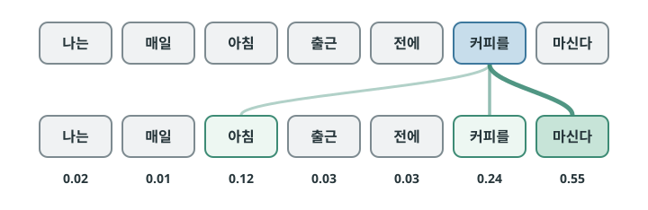{ .neural-network-image .transformer-image }

이후 각 토큰의 `V`에 해당 어텐션 가중치를 곱한 뒤 모두 더합니다. 따라서 관련성이 높은 “마신다”의 `V`는 더 많이, 나머지 토큰의 `V`는 관련성에 따라 서로 다른 비율로 반영됩니다. 그 결과 **“커피를”의 새로운 벡터에는 문장 전체에서 “커피를”과 관련된 정보가 중요도에 따라 함께 반영**됩니다. 이처럼 셀프 어텐션은 각 토큰의 벡터를 문맥에 맞는 새로운 벡터로 변환(transform)합니다. 이러한 변환은 트랜스포머의 핵심적인 특징 중 하나입니다.

그런데 셀프 어텐션에는 한 가지 문제가 있습니다. 토큰이 `n`개라면 각 토큰을 다른 모든 토큰과 비교해야 하므로 비교 횟수는 `n × n`, 즉 입력 길이의 제곱에 비례해 증가합니다. 그렇다면 문장이 수천, 수만 개의 토큰으로 길어진다면 어떻게 될까요?

입력이 길어질수록 계산량과 메모리 사용량이 증가하기 때문에 모델이 한 번에 처리할 수 있는 토큰 수에는 한계가 있습니다. 따라서 실제 모델에서는 한 번에 처리할 수 있는 토큰의 최대 길이를 제한합니다. 이렇게 정해진 최대 길이를 **문맥 창(context window)**이라고 합니다.

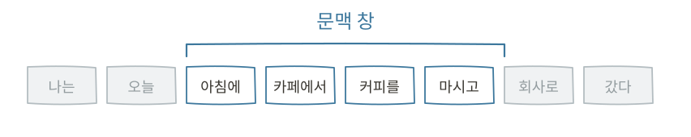{ .neural-network-image .transformer-image }

문맥 창이 커질수록 더 많은 정보를 함께 고려할 수 있지만, 그만큼 계산에 필요한 자원도 늘어납니다. 따라서 모델을 설계할 때는 필요한 문맥의 길이와 계산 비용을 고려해 적절한 크기를 설정해야 합니다. 최근에는 기술의 발전으로 문맥 창이 크게 확장되었습니다. 예를 들어 OpenAI의 GPT-5.4는 약 100만 개의 토큰을 처리할 수 있는 문맥 창을 지원합니다.

이제 트랜스포머를 이해하기 위한 핵심 개념을 모두 살펴봤습니다. 다음 장에서는 지금까지 배운 셀프 어텐션을 바탕으로, 여러 구성 요소가 어떻게 결합되어 트랜스포머라는 구조를 이루는지 좀 더 자세하게 살펴보겠습니다.

## :material-pencil: 실습 과제 {#exercises}

다음 문장이 맞으면 O, 틀리면 X를 선택하세요.

1. *Attention Is All You Need*는 어텐션이라는 개념을 처음 제안한 논문이다.
2. RNN은 이전 단계의 은닉 상태를 사용하므로 토큰을 순서대로 처리해야 한다.
3. 셀프 어텐션에서는 한 토큰이 자기 자신의 정보도 참고할 수 있다.
4. Query와 Key의 내적값이 클수록, 두 토큰의 관련성 점수도 높게 계산된다.
5. 트랜스포머의 셀프 어텐션은 문장에서 멀리 떨어진 토큰끼리도 직접 관계를 계산할 수 있다.

??? success "정답·해설"
    1. **X** — 바다나우를 비롯한 연구자들이 앞서 신경망 기반 기계번역에 어텐션 메커니즘을 제안했습니다.
    2. **O** — 이전 은닉 상태가 계산되어야 다음 단계로 갈 수 있어 병렬 처리에 제약이 있습니다.
    3. **O** — 셀프 어텐션은 자기 자신을 포함한 문장 안의 모든 토큰을 참고할 수 있습니다.
    4. **O** — Query와 Key의 내적값이 클수록, 현재 토큰이 찾는 정보와 해당 토큰이 더 잘 맞는다고 볼 수 있습니다.
    5. **O** — 두 토큰이 충분한 크기의 문맥 창 안에 함께 포함되어 있다면, 셀프 어텐션은 거리와 관계없이 직접 비교할 수 있습니다.
