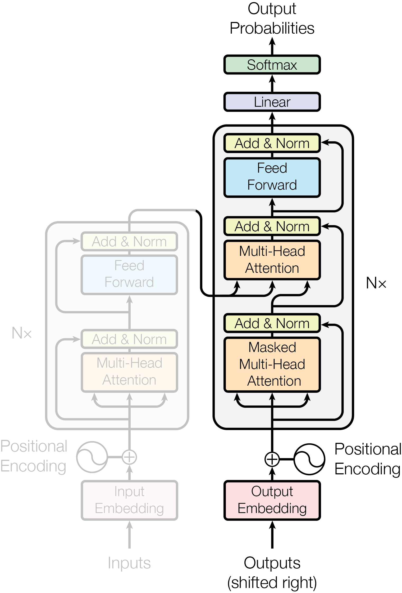
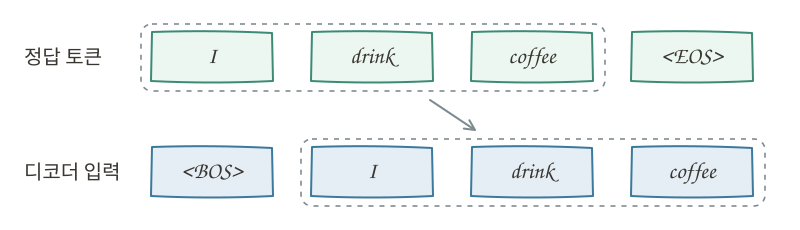
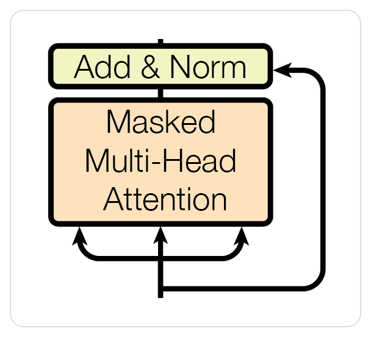
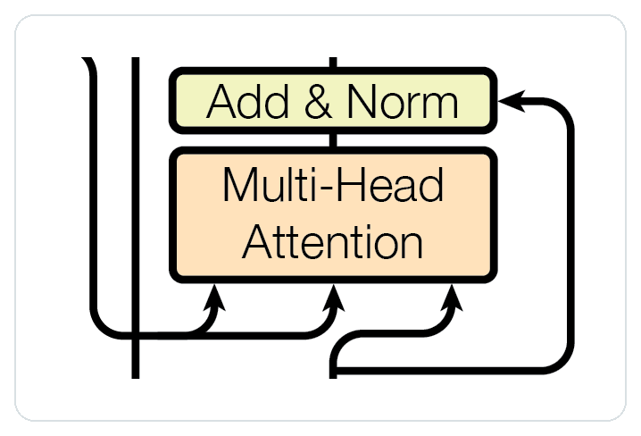
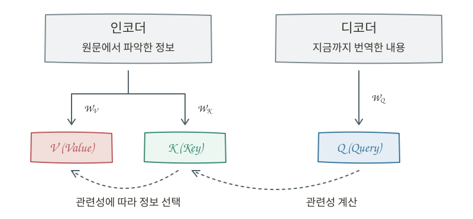
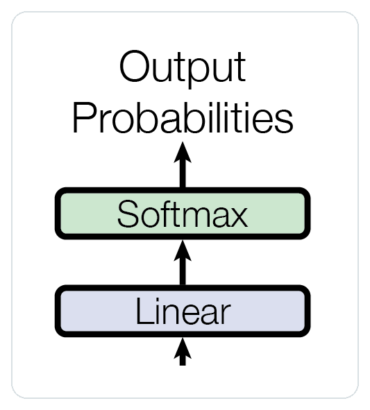

# 트랜스포머 뜯어보기: 디코더

이번에는 트랜스포머의 디코더에 대해 알아보겠습니다.

{ .neural-network-image .transformer-decoder-image style="width: min(100%, 22rem);" }

<em><a href="https://arxiv.org/html/1706.03762v7">Vaswani et al., *Attention Is All You Need* (2017), Figure 1</a></em>

## 출력 임베딩 {#output-embedding}

디코더도 인코더와 마찬가지로 토큰을 숫자 벡터로 바꾼 뒤 처리합니다. 다만 인코더에는 번역할 원문을 입력하는 반면, 디코더에는 번역문의 앞부분을 입력합니다.

예를 들어 한국어 문장 “나는 커피를 마신다”의 정답 번역이 `I drink coffee`라고 해 봅시다. 학습할 때는 정답 문장의 맨 앞에 시작을 나타내는 `<BOS>`(Beginning of Sequence) 토큰을 추가하고, 문장의 끝을 나타내는 `<EOS>`(End of Sequence) 토큰은 디코더 입력에서 제외합니다.

{ .neural-network-image .transformer-decoder-image }

이처럼 디코더 입력을 정답 문장보다 한 칸 오른쪽으로 이동시킨 형태를 Shifted Right라고 합니다. 디코더는 `<BOS>`를 보고 `I`를, `<BOS> I`를 보고 `drink`를, `<BOS> I drink`를 보고 `coffee`를 예측하도록 학습합니다. 마지막으로 `<BOS> I drink coffee`를 보고 `<EOS>`를 예측합니다.

디코더에 입력된 토큰도 토큰 ID를 거쳐 임베딩 벡터로 변환됩니다. 이를 **출력 임베딩(Output Embedding)**이라고 합니다. 여기서 ‘출력’은 번역문의 토큰이라는 의미이며, 만들어진 임베딩 벡터 자체는 디코더의 입력으로 사용됩니다.

마지막으로 인코더와 마찬가지로 위치 인코딩을 더해 토큰의 순서 정보를 반영한 뒤, 디코더 블록으로 전달합니다.

## 마스크드 다중 헤드 어텐션 {#masked-multi-head-attention}

{ .neural-network-image .transformer-decoder-image style="width: min(100%, 18rem);" }

디코더 블록의 첫 번째 층은 **마스크드 다중 헤드 어텐션(Masked Multi-Head Attention)**입니다. 인코더의 다중 헤드 어텐션과 마찬가지로 여러 어텐션 헤드를 통해 토큰 사이의 관계를 파악하지만, **미래 토큰을 미리 참고하지 않고 다음 토큰을 예측하도록 제한**한다는 차이가 있습니다.

예를 들어 `<BOS> I drink coffee`를 입력했을 때, `drink` 위치에서는 `<BOS>`, `I`, `drink`까지만 참고할 수 있도록 하고, 뒤에 있는 `coffee`는 참고하지 못하도록 가립니다.

이를 위해 토큰 자체를 제거하는 대신, 미래 토큰에 해당하는 어텐션 점수를 **음의 무한대(-∞)**로 설정합니다. 그러면 소프트맥스를 거친 어텐션 가중치가 `0`이 되어 해당 토큰의 정보가 반영되지 않습니다. 이렇게 하면 입력 구조와 행렬 연산을 유지하면서도 미래 토큰을 참고하지 못하도록 막을 수 있습니다.

마스킹된 상태에서 다중 헤드 어텐션을 수행한 뒤에는 인코더와 마찬가지로 Add & Norm을 거칩니다.

## 크로스 어텐션 {#cross-attention}

{ .neural-network-image .transformer-decoder-image style="width: min(100%, 18rem);" }

그다음은 **크로스 어텐션(Cross-Attention)**입니다. 크로스 어텐션은 **디코더가 인코더의 정보를 참고하는 과정**입니다.

도식을 보면 인코더의 출력과 디코더의 마스크드 셀프 어텐션을 거친 결과가 함께 Multi-Head Attention으로 전달됩니다. 이처럼 서로 다른 두 곳에서 나온 정보를 이용해 어텐션을 수행하기 때문에 크로스 어텐션이라고 부릅니다.

앞서 셀프 어텐션에서는 Q, K, V가 모두 같은 입력에서 만들어졌지만, 크로스 어텐션에서는 서로 다른 입력을 바탕으로 만들어집니다.

{ .neural-network-image .transformer-decoder-image }

각 표현에 학습된 가중치를 적용해 Q, K, V를 만들고, 이를 통해 디코더는 현재까지의 번역 내용을 바탕으로 **입력 문장의 어떤 부분에 주목해야 하는지** 계산합니다.

예를 들어 `coffee`를 예측할 때는 입력 문장 “나는 커피를 마신다”에서 “커피를”에 높은 어텐션 가중치를 부여해 필요한 정보를 참고할 수 있습니다.

크로스 어텐션을 거친 결과는 Add & Norm을 거쳐 FFN으로 전달됩니다. Add & Norm과 FFN의 구조와 역할은 앞서 살펴본 인코더와 동일합니다.

## 다음 토큰 예측 {#next-token}

{ .neural-network-image .transformer-decoder-image style="width: min(100%, 15rem);" }

크로스 어텐션과 피드 포워드 신경망을 거친 디코더의 최종 출력은 각 위치에서 다음에 올 토큰을 예측하는 데 사용됩니다.

먼저 Linear 층에서는 디코더의 출력 벡터를 바탕으로 어휘집에 있는 모든 토큰의 [로짓](07-probabilistic-language-modeling.md/#context)을 계산합니다. 로짓은 각 토큰이 다음에 올 가능성을 나타내는 점수로, 아직 확률로 변환되기 전의 값입니다.

예를 들어 어휘집에 `37,000`개의 토큰이 있다면 각 토큰에 하나씩 점수를 부여해 총 `37,000`개의 로짓을 출력합니다. 가령 `coffee`는 `4.2`, `tea`는 `2.1`, `apple`은 `0.7`과 같은 식입니다. 점수가 높을수록 다음 토큰으로 선택될 가능성이 높습니다.

그다음 소프트맥스는 로짓을 `0`과 `1` 사이의 확률로 변환합니다. 이렇게 계산된 모든 토큰의 확률을 더하면 `1`이 됩니다.

예를 들어 `<BOS> I drink`까지 생성했다면, `coffee`에는 높은 확률이, 다른 토큰에는 상대적으로 낮은 확률이 부여될 수 있습니다. 실제 번역할 때는 이 확률 분포를 바탕으로 다음 토큰 하나를 선택하고, 이를 다시 디코더의 입력에 추가합니다. 이러한 과정을 반복하면서 문장을 한 토큰씩 생성합니다.

## 트랜스포머의 범용성 {#transformer-versatility}

테슬라의 AI 조직을 이끌었던 안드레 카파시(Andrej Karpathy)는 뛰어난 AI 연구자이자 복잡한 기술을 쉽게 설명하는 교육자로도 잘 알려져 있습니다. 그는 스탠퍼드 대학교의 [CS25 강의](https://www.youtube.com/watch?v=XfpMkf4rD6E) 트랜스포머에 관한 강연을 하기도 했습니다. 이 강연에서 그는 논문의 제목인 *Attention Is All You Need*보다 *Transformer: A General-Purpose, Efficient, Optimizable Computer*(범용적이고 효율적이며 최적화하기 좋은 컴퓨터)가 이 논문에 더 어울리는 제목이었을 것이라는 의견을 내놓기도 했습니다.

그만큼 트랜스포머는 특정 분야에 한정되지 않고 **다양한 종류의 데이터를 처리할 수 있는 범용적인 구조**입니다. 처음에는 기계 번역과 같은 자연어 처리에 활용되었지만, 이후 이미지, 음성, 영상, 로보틱스 등 다양한 분야로 활용 범위가 확장되었습니다. 이미지나 음성, 영상도 일정한 단위의 시퀀스로 표현하면 트랜스포머의 핵심 원리를 적용할 수 있기 때문입니다.

## :material-pencil: 실습 과제 {#exercises}

다음 문장이 맞으면 O, 틀리면 X를 선택하세요.

1. 디코더의 출력 임베딩에는 정답 번역문 앞에 `<BOS>` 토큰을 붙여 입력한다.
2. 마스크드 다중 헤드 어텐션은 현재 위치보다 뒤에 있는 토큰을 참고하지 못하도록 한다.
3. 크로스 어텐션에서는 디코더의 표현으로 Q를 만들고, 인코더의 출력으로 K와 V를 만든다.
4. Linear 층의 출력은 모든 값을 더하면 1이 되는 다음 토큰의 확률 분포이다.
5. 트랜스포머는 이미지, 음성, 영상 등 시퀀스로 표현할 수 있는 다양한 데이터에도 활용할 수 있다.

??? success "정답·해설"
    1. **O** — 이렇게 한 칸 오른쪽으로 옮기는 것을 Shifted Right라고 합니다.
    2. **O** — 미래 토큰의 어텐션 점수를 가려, 아직 생성하지 않은 정답을 미리 볼 수 없도록 합니다.
    3. **O** — 디코더가 무엇을 찾을지 나타내는 Q를 만들고, 인코더의 출력이 K와 V가 되어 입력 문장의 정보를 제공합니다.
    4. **X** — Linear 층은 토큰별 점수인 로짓을 출력합니다. Softmax를 거쳐야 확률 분포가 됩니다.
    5. **O** — 데이터를 토큰 또는 시퀀스 형태로 표현할 수 있으면, 트랜스포머 구조를 다양한 분야에 적용할 수 있습니다.
