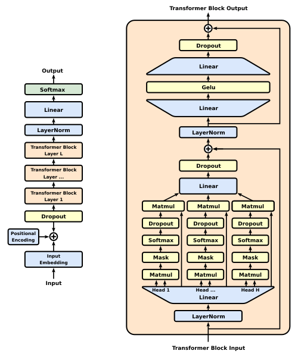
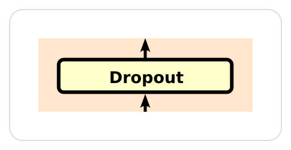
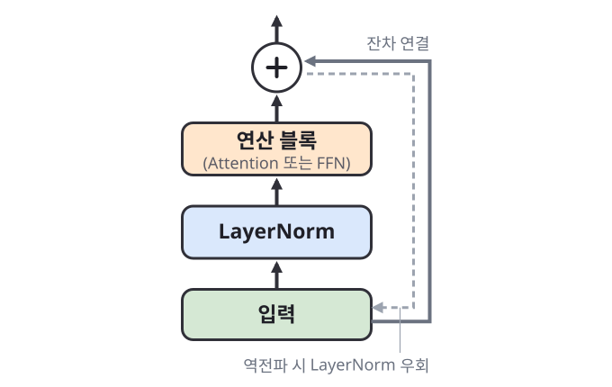
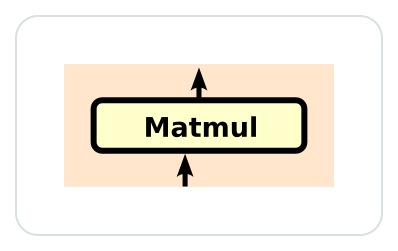
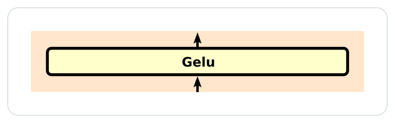
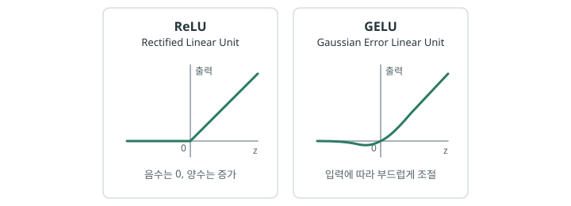

# 대화하는 트랜스포머

지금까지 트랜스포머가 어떤 구조로 이루어져 있고, 어떻게 동작하는지 살펴봤습니다. 이제 우리가 실제로 사용하는 **대규모 언어 모델(LLM)**을 이해할 준비가 되었습니다. 다음으로 트랜스포머가 현대 LLM로 발전해 온 과정과 LLM의 구조 및 동작 원리를 알아봅시다.

## 디코더 기반 언어 모델: GPT {#gpt}

초기 트랜스포머는 번역을 위해 인코더와 디코더를 함께 사용했습니다. 이후 연구자들은 트랜스포머를 **언어 모델(language model)**에도 적용하기 시작했습니다. 언어 모델은 단어들이 어떤 순서로 나타나는지 학습하는 모델로, 대표적인 방식 중 하나는 **앞에 나온 단어들을 바탕으로 다음에 어떤 단어가 나올지 예측하는 것**입니다. 이러한 예측을 반복하면 새로운 문장을 만들어 낼 수 있습니다.

!!! info "기계 번역과 언어 모델"
    **기계 번역**은 원문과 지금까지 생성한 번역문을 바탕으로 다음 토큰을 예측합니다. 초기 트랜스포머에서는 원문을 처리하는 인코더와 이를 참고해 번역문을 생성하는 디코더를 함께 사용했습니다. (예: `나는 커피를 마신다 + I drink` → `coffee`)

    **언어 모델**은 앞에 나온 토큰을 바탕으로 다음 토큰을 예측합니다. 별도의 원문을 처리하는 인코더가 필요하지 않으므로, 디코더만으로도 구성할 수 있습니다. (예: : `I drink` → `coffee`)

언어 모델은 기계 번역과 달리 별도의 원문을 입력받아 처리할 필요가 없습니다. 따라서 연구자들은 인코더를 제외하고 디코더만 사용하는 구조에도 주목하기 시작했습니다.

이러한 **디코더 온리(Decoder-only) 트랜스포머의 대표적인 모델**이 GPT입니다. GPT는 **Generative Pre-trained Transformer**의 약자로, 대규모 텍스트로 사전 학습(Pre-training)을 수행하고 이를 바탕으로 새로운 텍스트를 생성하는 트랜스포머 모델입니다.

2018년 OpenAI가 발표한 GPT-1을 시작으로 GPT-2와 GPT-3를 거치며 모델의 규모와 성능은 크게 향상되었습니다. 오늘날 많은 생성형 LLM 역시 세부적인 차이는 있지만, GPT와 마찬가지로 디코더 온리 트랜스포머를 기반으로 다음 토큰을 예측하는 기본 원리를 공유합니다.

그렇다면 GPT는 어떤 구조로 이루어져 있을까요? 여기서는 GPT-2를 기준으로 살펴보겠습니다. GPT-2는 현대 생성형 LLM의 기반이 되는 디코더 온리 트랜스포머의 구조를 잘 보여줍니다. 아래 그림에서 왼쪽은 GPT의 전체적인 데이터 처리 흐름을, 오른쪽은 반복되는 트랜스포머 블록 하나의 내부 구조를 보여줍니다.

{ .neural-network-image .chatgpt-image style="width: min(100%, 34rem);" }

<em><a href="https://en.wikipedia.org/wiki/File:Full_GPT_architecture.svg">Full GPT architecture, CC0</a></em>

먼저 왼쪽의 GPT 전체 구조를 보면, 기존 트랜스포머와 달리 인코더가 없고 디코더만 남아 있습니다. 따라서 인코더의 출력을 참고하는 크로스 어텐션(Cross-Attention)도 존재하지 않습니다.

그렇다고 해서 GPT에 입력이 없는 것은 아닙니다. 기존 트랜스포머에서는 번역할 원문을 인코더가 처리하고, 디코더는 그 결과와 지금까지 생성한 번역문을 바탕으로 다음 토큰을 예측했습니다. 반면 GPT에서는 **다음 토큰을 예측하기 위한 텍스트가 디코더에 직접 입력**됩니다. 이때 사용자가 입력한 문장뿐만 아니라 GPT가 생성한 문장도 함께 사용됩니다. 두 문장은 별도로 구분되지 않고, 하나의 연속된 텍스트처럼 처리됩니다.

예를 들어 “나는 매일 아침마다”라는 문장이 주어지면, GPT는 이를 토큰으로 나누어 처리하고 다음에 올 토큰을 예측합니다. 다음 토큰으로 “커피를”을 생성했다고 해보겠습니다. 그러면 “커피를”이 기존 입력 뒤에 이어지고, GPT는 “나는 매일 아침마다 커피를”이라는 문맥을 바탕으로 다시 다음 토큰인 “마신다”를 예측합니다.

이처럼 지금까지 주어진 토큰과 자신이 생성한 토큰을 바탕으로 다음 토큰을 하나씩 이어서 생성하는 방식을 **자기회귀(Autoregressive) 방식**이라고 합니다.

## GPT의 트랜스포머 블록 {#gpt-transformer-block}

GPT의 트랜스포머 블록은 앞서 살펴본 트랜스포머의 디코더와 기본적인 구조가 비슷합니다. 다만 그림에는 몇 가지 낯선 요소들이 등장합니다.

### Dropout {#dropout}

{ .neural-network-image .chatgpt-image style="width: min(100%, 18rem);" }

먼저 노란색 박스로 표시된 **Dropout**을 살펴보겠습니다. Dropout은 앞서 살펴본 트랜스포머 구조에는 별도로 표시되지 않았지만, 실제로는 여러 부분에 사용되었습니다. GPT 역시 모델의 여러 부분에 Dropout을 적용합니다.

신경망을 학습하다 보면 학습 데이터의 특정 패턴에 지나치게 맞춰져, 새로운 데이터에 대한 예측 성능이 떨어지는 경우가 있습니다. 이러한 현상을 **과적합(Overfitting)**이라고 합니다.

신경망은 학습에 사용한 데이터뿐만 아니라 처음 보는 데이터에서도 좋은 성능을 내야 합니다. 따라서 과적합을 줄이는 것이 중요하며, 이를 위한 방법 중 하나가 Dropout입니다. Dropout은 **학습 과정에서 일부 뉴런의 출력을 무작위로 0으로 만들어 일시적으로 사용하지 않는 기법**입니다. 학습할 때마다 일부 뉴런을 무작위로 제외함으로써 특정 뉴런에 지나치게 의존하는 것을 방지합니다.

이는 축구에서 오른발만 주로 사용하던 선수가 훈련할 때 일부러 오른발 사용을 제한하고 왼발로 패스와 슈팅을 연습하는 것과 비슷합니다. 익숙한 오른발을 사용할 수 없게 되면 평소 잘 사용하지 않던 왼발도 활용하게 되는 것입니다. 이처럼 Dropout은 모델이 다양한 뉴런과 특징을 활용하도록 유도해 과적합을 줄이는 데 도움을 줍니다.

### Pre-LN {#pre-ln}

  
  

다음으로 **LayerNorm(Layer Normalization)**이 있습니다. 이는 앞서 트랜스포머의 Add & Norm에서 살펴본 레이어 정규화와 같은 연산입니다.

다만 GPT-2에서는 정규화를 적용하는 위치가 달라졌습니다. 기존 트랜스포머에서는 Attention이나 FFN 연산의 출력에 원래 입력을 더한 뒤 정규화했습니다. 반면 GPT-2에서는 **Attention과 FFN 연산을 수행하기 전에 먼저 정규화**하고, 연산 결과에 원래 입력을 더합니다. 이처럼 정규화를 각 연산의 앞에 배치하는 구조를 **Pre-LN(Pre-Layer Normalization)**이라고 합니다.

왼쪽 그림에서는 어텐션 연산 앞에 LayerNorm이 배치된 모습을 볼 수 있습니다. 이러한 구조는 오른쪽 그림의 FFN에서도 동일하게 적용됩니다. 오른쪽 그림에 표시된 Linear → GELU → Linear 구조는 앞서 트랜스포머에서 살펴본 FFN에 해당하며, LayerNorm을 먼저 적용한 뒤 FFN 연산을 수행하고 그 결과에 원래 입력을 더합니다.

Pre-LN이라는 이름은 순전파 과정에서 Attention이나 FFN 연산보다 먼저 정규화를 수행한다는 뜻입니다. 이처럼 정규화를 앞에 배치하면, **잔차 연결을 통해 원래 입력이 정규화를 거치지 않고 다음 층으로 직접 전달되는 경로**가 만들어집니다.

{ .neural-network-image .chatgpt-image style="width: min(100%, 34rem);" }

역전파 과정에서도 기울기는 이 경로를 따라 입력에 가까운 이전 층들까지 비교적 직접적으로 전달될 수 있습니다. 따라서 여러 층을 거치면서 기울기가 지나치게 작아지거나 불안정해지는 문제를 완화하고, **트랜스포머 블록을 깊게 쌓아도 학습을 안정적으로 진행**하는 데 도움이 됩니다.

### MatMul {#matmul}

{ .neural-network-image .chatgpt-image style="width: min(100%, 18rem);" }

다음으로 **MatMul**은 행렬 곱(Matrix Multiplication)을 뜻합니다. 앞서 각 토큰의 벡터에 가중치 행렬을 곱해 Q, K, V를 만들었던 것처럼, 여러 벡터에 행렬 연산을 수행할 때 사용됩니다. 이때 토큰마다 벡터를 하나씩 계산하는 대신, 여러 토큰의 벡터를 하나의 행렬로 묶어 한꺼번에 계산할 수 있습니다. 이러한 방식은 GPU의 병렬 처리 능력을 활용해 연산을 효율적으로 수행할 수 있다는 장점이 있습니다.

!!! info "GPU(Graphics Processing Unit)란?"
    컴퓨터에는 프로그램을 실행하고 다양한 계산을 수행하는 CPU(Central Processing Unit)라는 연산 장치가 있습니다. CPU도 계산을 빠르게 수행하지만, 수많은 계산을 동시에 처리하는 데는 GPU(Graphics Processing Unit)가 더 유리합니다. GPU는 원래 게임이나 3D 그래픽을 빠르게 처리하기 위해 개발되었지만, 이러한 병렬 처리 능력 덕분에 딥러닝에도 널리 사용됩니다. 앞서 살펴본 벡터와 행렬의 곱셈 같은 연산도 주로 GPU에서 이루어지며, 모델의 학습과 실행 속도를 높이는 데 중요한 역할을 합니다.

### GELU {#gelu}

{ .neural-network-image .chatgpt-image style="width: min(100%, 18rem);" }

마지막으로 FFN에서는 기존 트랜스포머의 ReLU 대신 **GELU(Gaussian Error Linear Unit)**라는 활성화 함수를 사용합니다. ReLU가 음수 값을 모두 0으로 만드는 방식이라면, GELU는 입력값에 따라 출력을 부드럽게 조절합니다. 따라서 ReLU와 달리 음수 값도 일부 유지하며, 입력값이 변할 때 출력값도 연속적이고 부드럽게 변화합니다.

{ .neural-network-image .chatgpt-image }

## ChatGPT {#chatgpt}

지금까지 GPT의 기본적인 구조와 동작 원리를 살펴보았습니다. GPT는 대규모 텍스트를 학습하고, 주어진 문맥을 바탕으로 다음 토큰을 예측해 문장을 생성할 수 있습니다.

하지만 GPT가 단순히 문장을 생성하는 것을 넘어 **사용자의 지시를 따르고 자연스럽게 대화를 나누도록** 하려면 추가적인 학습이 필요합니다. 이를 위해 사람이 작성한 모범 답변을 학습시키거나, 여러 답변 중 사람이 선호하는 답변을 바탕으로 모델을 조정하는 방법이 활용됩니다.

이러한 학습 방법을 적용한 대표적인 모델이 OpenAI의 **InstructGPT**입니다. InstructGPT는 기존 GPT-3를 기반으로 **지도 미세조정(SFT, Supervised Fine-Tuning)**과 **인간 피드백을 통한 강화학습(RLHF, Reinforcement Learning from Human Feedback)**을 적용해, 사용자의 지시를 더 잘 따르도록 만든 모델입니다.

먼저 **지도 미세조정(SFT)**은 모델에게 좋은 답변의 예시를 직접 보여주는 과정입니다. 사람이 작성한 지시와 답변으로 이루어진 데이터를 이용해 모델을 추가로 학습합니다. 예를 들어 “프랑스의 수도를 알려줘”라는 지시에 “프랑스의 수도는 파리입니다”라고 답하는 예시를 학습시키는 것입니다. 이러한 예시를 반복해서 학습하면서 모델은 사용자의 지시에 어떤 방식으로 답해야 하는지 익히게 됩니다.

하지만 좋은 답변의 예시를 보여주는 것만으로는 충분하지 않습니다. 하나의 질문에도 다양한 답변이 가능하며, 그중 어떤 답변이 더 유용하고 적절한지에 대한 **사람의 선호를 학습에 반영**할 필요가 있습니다. 이를 위해 사용되는 방법이 인간 피드백을 통한 강화학습(RLHF)입니다.

RLHF에서는 먼저 하나의 질문에 대해 모델이 여러 답변을 생성하고, 사람이 답변들을 비교해 더 선호하는 답변을 선택합니다. 이렇게 수집한 선호 데이터를 이용해 어떤 답변을 사람이 더 선호할지 예측하는 **보상 모델(Reward Model)**을 학습합니다. 이후 GPT는 이 보상 모델로부터 더 높은 점수를 받는 방향으로 강화학습을 수행합니다.

즉, SFT가 “이렇게 답하면 된다”라는 좋은 답변의 예시를 보여주는 과정이라면, RLHF는 “이 답변보다 저 답변이 더 좋다”라는 사람의 선호를 알려주는 과정이라고 볼 수 있습니다. 이를 통해 모델은 단순히 지시를 따르는 것을 넘어, 사람이 더 선호하는 방식으로 답변하도록 조정됩니다.

이후 이러한 학습 방식을 대화형 AI에 적용해 2022년 공개한 서비스가 ChatGPT입니다. 초기 ChatGPT는 GPT-3.5 계열 모델을 기반으로, 사람이 사용자와 AI의 역할을 나누어 작성한 대화 데이터를 이용해 지도 미세조정을 수행하고, 여기에 RLHF를 적용했습니다. 이를 통해 사용자의 지시에 적절히 응답하고, 이전 대화의 맥락을 반영해 자연스럽게 대화를 이어가는 능력을 강화했습니다.

정리하면 GPT와 초기 ChatGPT의 기반 모델은 모두 디코더 온리 트랜스포머 구조를 사용합니다. 이전 토큰을 바탕으로 다음 토큰을 예측하는 기본 원리는 같지만, ChatGPT는 여기에 대화 데이터와 사람의 선호를 반영하는 추가 학습을 더해 대화에 적합하도록 조정한 것입니다.

## 거대 언어 모델의 탄생 {#llm}

이러한 발전을 조금 더 큰 관점에서 바라보면, 오늘날의 **거대 언어 모델(LLM, Large Language Model)**은 어느 날 갑자기 등장한 기술이 아닙니다. 앞서 살펴본 트랜스포머를 비롯한 모델 구조와 다양한 학습 방법의 발전, 그리고 방대한 데이터와 연산 자원이 결합된 결과입니다.

1장에서 머신러닝의 학습을 **데이터, 모델, 학습 방법**이라는 [세 가지 요소](01-machine-learning.md/#three-elements-of-learning)로 나누어 살펴봤습니다. ChatGPT의 발전 역시 이 세 요소를 통해 이해할 수 있습니다. 트랜스포머라는 강력한 모델 구조가 등장했고, 사전학습과 미세조정, RLHF와 같은 학습 방법이 발전했으며, 인터넷 등을 통해 축적된 방대한 텍스트 데이터를 활용할 수 있게 되었습니다.

결국 오늘날의 LLM은 데이터, 모델, 학습 방법이라는 세 요소가 서로 맞물려 발전해 온 결과물이라고 볼 수 있습니다.

## :material-pencil: 실습 과제 {#exercises}

다음 문장이 맞으면 O, 틀리면 X를 선택하세요.

1. GPT는 앞서 생성한 토큰을 다시 입력에 포함해 다음 토큰을 예측한다.
2. GPT는 인코더의 출력을 참고하기 위해 크로스 어텐션을 사용한다.
3. Pre-LN은 Attention이나 FFN 연산을 수행하기 전에 LayerNorm을 적용한다.
4. 지도 미세조정에서는 사람이 작성한 지시-답변 예시를 이용해 모델을 추가로 학습한다.
5. RLHF에서는 사람이 어떤 답변을 더 선호하는지에 대한 피드백을 학습에 반영한다.

??? success "정답·해설"
    1. **O** — 생성한 토큰을 입력에 이어 붙이며 다음 토큰을 반복해서 예측하는 자기회귀 방식입니다.
    2. **X** — GPT는 인코더가 없는 디코더 온리 구조이므로 크로스 어텐션도 사용하지 않습니다.
    3. **O** — LayerNorm을 각 연산 앞에 둔 구조를 Pre-LN이라고 합니다.
    4. **O** — 사람이 작성한 지시-답변 데이터를 이용해, 사용자의 지시에 답하는 방식을 학습합니다.
    5. **O** — 사람의 선호 데이터를 이용해 더 좋은 답변을 선택하는 방향으로 모델을 조정합니다.
