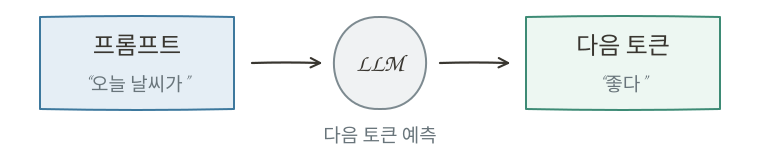
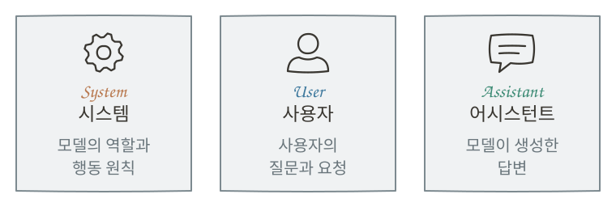

# LLM에게 지시하는 방법 {#prompting}

## 프롬프트 {#prompt}

거대 언어 모델(LLM)은 주어진 문맥을 바탕으로 다음 토큰을 예측해 텍스트를 생성합니다. 하지만 같은 모델이라도 어떤 내용을, 어떤 방식으로 입력하느냐에 따라 생성되는 답변은 크게 달라질 수 있습니다.

이처럼 LLM에 전달하는 입력을 **프롬프트(Prompt)**라고 합니다. 프롬프트는 단순한 질문일 수도 있지만, 모델이 참고할 배경 정보와 수행할 작업, 답변의 형식이나 조건까지 함께 전달할 수도 있습니다.

LLM은 프롬프트에 포함된 정보를 문맥으로 활용하며, 입력된 내용에 따라 다음 토큰의 예측 확률이 달라집니다. 따라서 같은 질문이라도 **어떤 배경 정보를 제공하고 어떤 조건을 제시하느냐**에 따라 답변의 내용과 형태가 달라질 수 있습니다. 즉, 프롬프트는 LLM이 생성하는 답변의 방향과 품질에 영향을 미치는 중요한 요소입니다.

{ .neural-network-image }

## 프롬프트의 종류 {#prompt-types}

대화형 LLM에서는 대화를 여러 메시지로 나누고, 각 메시지에 **역할(Role)**을 부여해 구분합니다. 대표적으로 시스템(System), 사용자(User), 어시스턴트(Assistant) 역할이 있습니다. 모델은 이러한 역할 정보와 함께 대화 내용을 처리하기 때문에, 같은 문장이라도 어떤 역할로 전달되느냐에 따라 다르게 반응할 수 있습니다.

{ .neural-network-image }

### 시스템 프롬프트 {#system-prompt}

시스템 프롬프트는 **모델의 역할과 전반적인 행동 원칙**을 설정합니다. 예를 들어 “모든 답변은 한국어로 작성한다” 또는 “욕설이나 혐오 표현을 포함한 부적절한 표현은 사용하지 않는다”와 같은 지시를 둘 수 있습니다.

일반적으로 시스템 프롬프트는 서비스를 사용하는 사용자에게 직접 보이지 않으며, LLM을 활용해 서비스를 만드는 개발자가 미리 작성해 모델에 전달합니다. 이를 통해 사용자가 매번 반복해서 요청하지 않아도 서비스 전반에 적용할 기본적인 지침을 설정할 수 있습니다.

### 사용자 프롬프트 {#user-prompt}

사용자 프롬프트는 **사용자가 모델에게 직접 전달하는 질문이나 요청**입니다. “이 글을 세 문장으로 요약해 줘”처럼 수행할 작업을 지시하거나, 필요한 자료와 조건을 함께 제공할 수 있습니다. 따라서 LLM이 원하는 작업을 수행하도록 하려면 사용자 프롬프트를 명확하게 작성하는 것이 중요합니다.

### 어시스턴트 메시지 {#assistant-message}

어시스턴트 메시지는 **모델이 생성한 답변**입니다. 대화형 서비스에서는 이후 사용자가 새로운 질문을 하면, 이전 사용자 메시지와 어시스턴트 메시지 등 필요한 대화 기록을 함께 모델에 전달할 수 있습니다. 이를 통해 모델은 이전 대화 내용을 참고하면서 대화의 흐름을 이어가고 새로운 답변을 생성할 수 있습니다.

### 대화 예시 {#chat-example}

이 세 가지 메시지는 각각 독립적으로 사용되는 것이 아니라, 하나의 대화 안에서 함께 사용됩니다. 예를 들어 사용자가 채팅창에 다음과 같이 질문할 수 있습니다.

  
User머신러닝이 뭐야?

사용자가 직접 입력한 것은 이 문장뿐이지만, 모델에는 서비스에서 미리 설정한 시스템 프롬프트도 함께 전달될 수 있습니다. 모델은 시스템 프롬프트와 사용자 프롬프트를 함께 참고해 답변을 생성합니다.

  

System모든 답변은 한국어로 작성한다. 욕설이나 혐오 표현은 사용하지 않는다.

  
User머신러닝이 뭐야?

  
Assistant컴퓨터가 데이터에서 패턴을 학습하는 기술입니다.

## 대화의 맥락 {#context}

대화 예시에서는 시스템 프롬프트와 사용자 프롬프트를 함께 전달했습니다. 여기서 사용자가 대화를 이어 나가면, 모델은 이전 대화 내용을 참고해 답변을 생성합니다.

이는 일상적인 대화에서도 마찬가지입니다. 친구와 메신저로 여행 계획을 이야기하다가 “그럼 토요일은 어때?”라고 물으면, 친구는 이전 대화 내용을 바탕으로 여행 날짜를 묻는 말이라는 것을 이해합니다.

이처럼 대화의 의미를 이해하는 데 필요한 배경 정보와 앞선 내용을 **컨텍스트(Context)**라고 합니다. LLM에서도 컨텍스트는 모델이 현재 답변을 생성할 때 참고하는 정보를 의미합니다.

이어서 “머신러닝이 뭐야?”라는 질문에 이어 사용자가 “조금 더 쉽게 설명해 줘”라고 요청하면, 모델은 머신러닝에 대한 설명을 더 쉽게 해 달라는 뜻으로 이해하고 답변할 수 있습니다. 이는 **새로운 질문과 함께 이전에 주고받은 메시지들도 다시 모델에 입력**되기 때문입니다. 즉, 이전 대화가 컨텍스트로 함께 전달되기 때문에 모델은 현재 질문의 의미를 파악하고 대화의 흐름에 맞는 답변을 생성할 수 있습니다.

  

    

      이전 대화
      
<b>System</b>모든 답변은 한국어로 작성한다

      
<b>User</b>머신러닝이 뭐야?

      
<b>Assistant</b>데이터에서 패턴을 학습하는 기술입니다.

    

    
+

    

      새 사용자 메시지
      
<b>User</b>조금 더 쉽게 설명해 줘.

    

  

  
↓

  

    <b>LLM</b>
  

  
↓

  

    새로운 답변
    
<b>Assistant</b>컴퓨터가 데이터를 보고 규칙을 배우는 기술입니다.

  

컨텍스트에는 대화 내용뿐만 아니라 사용자가 제공한 자료나 문서, 외부 도구를 통해 가져온 정보 등도 포함될 수 있습니다. 모델은 이러한 정보를 참고해 질문의 의미를 파악하고 답변을 생성합니다.

따라서 LLM을 효과적으로 활용하려면 프롬프트를 어떻게 작성하는지뿐만 아니라 어떤 정보를 컨텍스트로 제공할지도 중요합니다. 필요한 정보가 빠져 있으면 정확한 답변을 생성하기 어렵고, 반대로 관련 없는 정보가 지나치게 많으면 중요한 정보를 제대로 활용하지 못할 수도 있습니다.

이처럼 모델이 작업에 필요한 정보를 선별하고 적절하게 구성하며 관리하는 것을 **컨텍스트 관리(Context Management)**라고 합니다. 대화가 길어지거나 복잡한 작업을 수행할수록 어떤 정보를 유지하고 어떤 정보를 제외할지 결정하는 것이 중요해집니다.

실제로 일부 대화형 AI 서비스에서는 대화가 길어지면 이전 대화의 핵심 내용을 요약해 모델에 전달하기도 합니다. 이를 통해 중요한 맥락을 유지하면서도 불필요한 정보를 줄일 수 있습니다.

컨텍스트 관리는 처리 속도와 비용에도 영향을 미칩니다. 모델에 전달하는 정보가 많아질수록 입력 토큰 수가 증가하고, 이를 처리하는 데 필요한 시간과 비용도 늘어날 수 있기 때문입니다. 따라서 적절한 컨텍스트 관리는 **답변의 품질과 처리 효율을 모두 높이는 데 중요**합니다.

## 주요 프롬프팅 기법 {#prompting-techniques}

LLM에서 원하는 결과를 얻으려면 단순히 질문을 입력하는 것을 넘어, 필요한 정보와 지시를 어떻게 구성해 전달할지 고민해야 합니다. 같은 작업이라도 어떤 정보와 예시를 제공하고, 어떤 방식으로 요청하느냐에 따라 답변이 달라질 수 있습니다.

이처럼 프롬프트를 효과적으로 구성하는 방법에는 여러 가지가 있습니다. 그중 LLM을 활용할 때 자주 사용되는 대표적인 프롬프팅 기법을 살펴보겠습니다.

### Few-shot Prompting {#few-shot-prompting}

퓨샷 프롬프팅(Few-shot Prompting)은 모델에게 작업을 요청할 때 **몇 개의 예시를 함께 제공**하는 방법입니다. 작업에 대한 설명과 함께 실제 입력과 출력의 예시를 보여주어, 모델이 원하는 결과의 패턴을 파악하도록 합니다.

몇 개의 주요 키워드를 바탕으로 마케팅 문구를 만드는 작업을 예로 들어 보겠습니다.

**프롬프트 예시**

> 다음 예시를 참고해 주어진 키워드로 마케팅 문구를 작성한다

> **키워드**: 커피, 아침, 활력  
> **문구**: 하루의 시작을 깨우는 한 잔의 커피
>
> **키워드**: 여행, 자유, 새로운 경험  
> **문구**: 익숙함을 떠나, 새로운 세상을 만나는 순간
>
> **키워드**: 운동, 건강, 습관  
> **문구**: 

모델은 제공된 예시를 참고해 키워드를 어떤 방식으로 조합하고, 어느 정도의 길이와 문체로 문구를 작성해야 하는지 파악할 수 있습니다.

다만 퓨샷 프롬프팅은 어떤 예시를 제공하느냐에 따라 결과가 달라질 수 있습니다. 따라서 실제 작업과 유사하고, 원하는 결과를 잘 보여주는 예시를 선택하는 것이 중요합니다.

### Structured Prompting {#structured-prompting}

구조화된 프롬프팅(Structured Prompting)은 프롬프트에 포함할 내용을 **역할, 목표, 배경 정보, 제약 조건, 출력 형식 등의 요소로 나누어 작성하는 방법**입니다.

단순한 작업이라면 한두 문장의 지시만으로도 충분하지만, 요구사항이 많아질수록 여러 조건을 구분 없이 나열하면 일부 조건이 누락되거나 의도가 명확하게 전달되지 않을 수 있습니다. 이때 프롬프트를 항목별로 구조화하면 각 요구사항을 명확하게 전달할 수 있고, 사용자 역시 내용을 확인하고 수정하기 편해집니다.

예를 들어 여행 계획을 요청한다면 다음과 같이 구성할 수 있습니다.

**프롬프트 예시**
> **역할:** 여행 플래너 
> **목표:** 제주도 2박 3일 여행 일정을 작성한다 
> **대상:** 부모님과 함께 여행하는 4인 가족 
> **조건:** 하루에 관광지는 3곳 이하로 방문하고, 이동 시간을 최소화한다 
> **출력 형식:** 날짜별로 오전, 오후, 저녁 일정을 표로 정리한다

구조화된 프롬프팅에 반드시 정해진 형식이 있는 것은 아닙니다. 작업에 필요한 요소를 적절히 구분하여 모델이 수행할 작업과 지켜야 할 조건을 명확하게 전달하는 것이 핵심입니다.

### Prompt Chaining {#prompt-chaining}

프롬프트 체이닝(Prompt Chaining)은 **하나의 복잡한 작업을 여러 단계로 나누고, 앞 단계에서 생성한 결과를 다음 단계의 프롬프트에 활용하는 방법**입니다.

예를 들어 긴 자료를 바탕으로 보고서를 작성한다면 처음부터 완성된 보고서를 요청하는 대신 다음과 같이 작업을 나눌 수 있습니다.

1. 자료에서 핵심 내용을 추출한다.
2. 추출한 내용을 바탕으로 보고서의 목차를 만든다.
3. 목차에 따라 각 내용을 작성한다.
4. 완성된 보고서를 검토하고 수정한다.

**작업 흐름**
> 프롬프트 1 + `자료` → `핵심 내용` 추출 
> 프롬프트 2 + `핵심 내용` → `목차` 작성 
> 프롬프트 3 + `핵심 내용`·`목차` → `보고서` 작성 
> 프롬프트 4 + `보고서` → 검토 및 수정

각 단계의 결과는 다음 단계의 입력으로 이어집니다. 이렇게 복잡한 작업을 여러 단계로 나누면 각 단계에서 수행할 작업이 명확해지고, 중간 결과를 확인하거나 수정하기도 쉬워집니다.

다만 프롬프트 체이닝은 여러 차례 프롬프트를 실행해야 하므로 단순한 작업에서는 오히려 불필요하게 복잡할 수 있습니다. 따라서 한 번의 프롬프트로 처리하기 어려운 복잡한 작업에 활용하는 것이 효과적입니다.

## :material-pencil: 실습 과제 {#exercises}

다음 문장이 맞으면 O, 틀리면 X를 선택하세요.

1. 프롬프트는 생성형 LLM이 다음 토큰을 생성하기 위해 입력받는 텍스트이다.
2. 시스템 프롬프트는 모델의 역할과 대화 전반에 적용할 행동 원칙을 정하는 데 사용한다.
3. 이전 어시스턴트 메시지는 대화 기록으로만 저장되며, 다음 답변을 만들 때는 참고하지 않는다.
4. Few-shot Prompting은 원하는 작업의 입력과 출력 예시를 몇 개 함께 제공하는 방법이다.
5. Structured Prompting은 여러 요구사항을 하나의 문장으로 자연스럽게 이어 쓰는 방법이다.

??? success "정답·해설"
    1. **O** — LLM은 프롬프트를 입력으로 받아 다음 토큰을 예측하며 답변을 생성합니다.
    2. **O** — 시스템 프롬프트는 모델의 역할과 기본적인 행동 원칙을 전달합니다.
    3. **X** — 이전 메시지도 새로운 사용자 메시지와 함께 다시 모델의 입력으로 전달되어, 다음 답변의 맥락이 됩니다.
    4. **O** — 예시를 통해 모델이 원하는 입력과 출력의 패턴을 파악하도록 돕습니다.
    5. **X** — 역할, 목표, 조건, 출력 형식처럼 요구사항을 여러 항목으로 나누어 명확히 전달하는 방법입니다.
