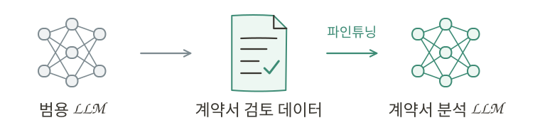
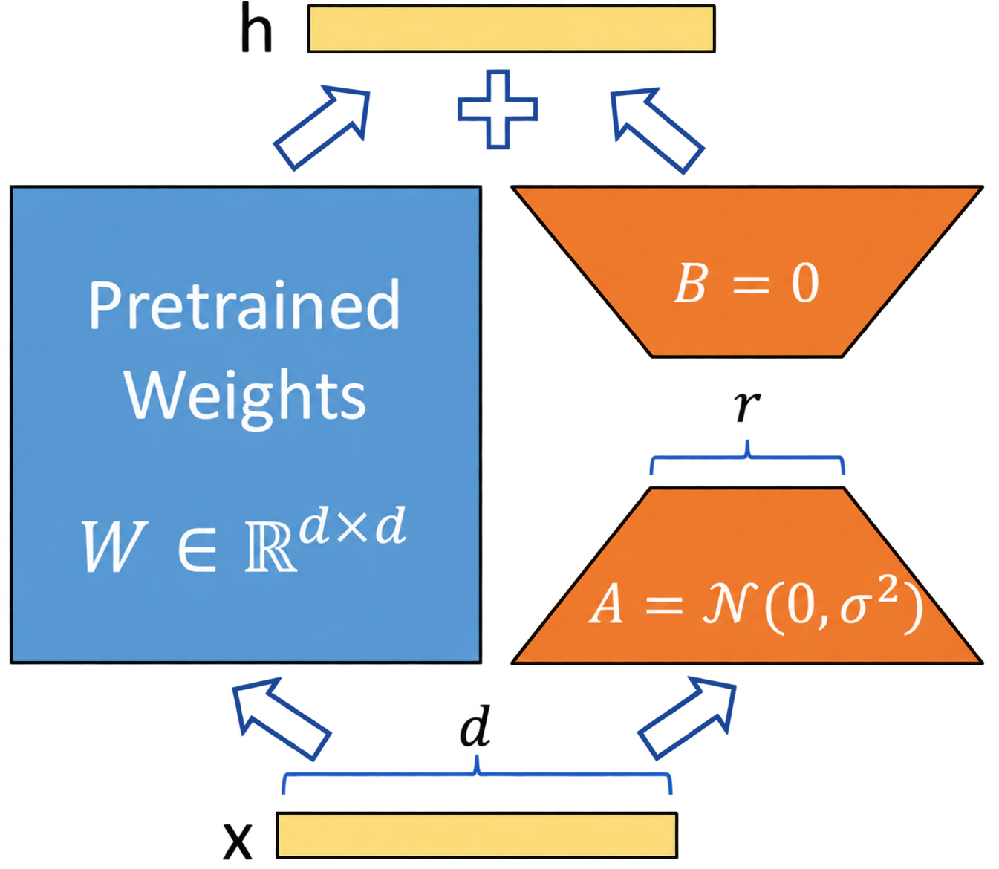
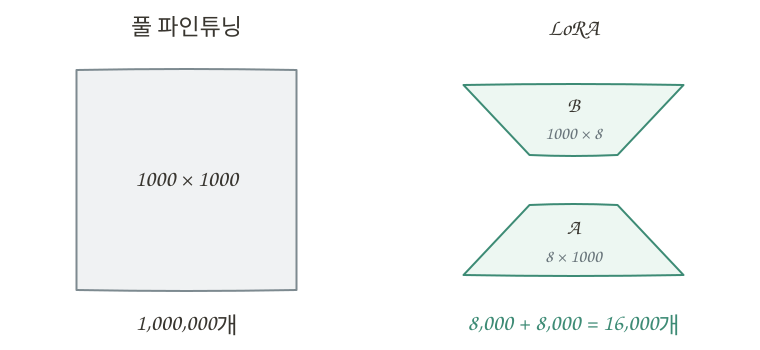
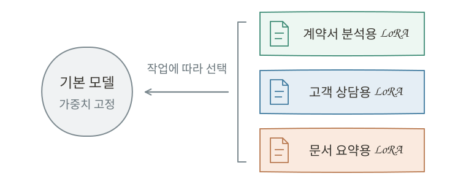
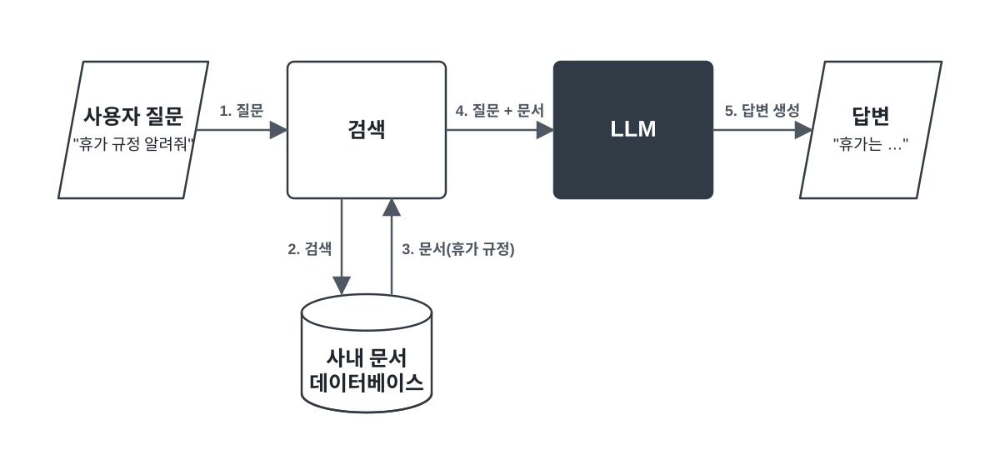
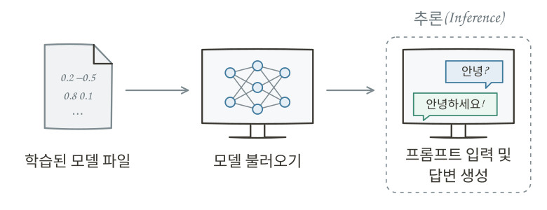
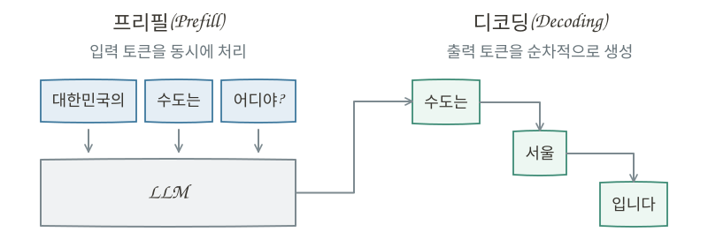
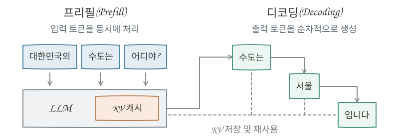

# LLM 학습, 그 이후 {#after-pretraining}

GPT와 같은 LLM은 방대한 텍스트를 학습하며 언어의 다양한 패턴과 지식을 익힙니다. 하지만 학습을 마친 모델이라도 **특정 작업에 최적화하거나, 학습 이후의 최신 정보와 특정 분야의 전문 지식을 활용하는 데에는 한계**가 있습니다.

이러한 한계를 보완하기 위해 모델을 추가로 학습시키거나, 외부 정보를 연결하는 등 다양한 기술이 활용됩니다. 이 장에서는 LLM의 학습 이후에 활용되는 주요 기술들을 하나씩 살펴보겠습니다.

## 파인튜닝 {#fine-tuning}

사전 학습을 마친 LLM은 다양한 주제와 작업을 처리할 수 있지만, 특정한 목적에 최적화되어 있는 것은 아닙니다.

예를 들어 계약서를 검토해 법적 검토가 필요한 조항을 찾아내는 모델이 필요하다고 가정해 보겠습니다. 범용 LLM도 프롬프트를 통해 이러한 작업을 수행할 수 있지만, 일정한 검토 기준에 따라 많은 문서를 일관되게 분석하는 데에는 한계가 있을 수 있습니다.

이처럼 특정 작업을 더 정확하고 일관되게 수행하도록 모델 자체를 조정하고 싶을 때 **파인튜닝(Fine-tuning)**을 사용할 수 있습니다. 파인튜닝은 사전 학습된 모델에 **추가 데이터를 학습시켜 특정 작업이나 목적에 맞게 모델을 조정**하는 방법입니다.

이미 학습된 모델을 기반으로 하기 때문에 처음부터 새로운 모델을 만드는 것보다 적은 데이터와 연산 자원으로 원하는 작업에 적응시킬 수 있습니다.

앞선 계약서 분석 모델이라면, 실제 계약서와 함께 주의해서 살펴봐야 할 조항을 표시한 학습 데이터를 제공할 수 있습니다. 모델은 이러한 예시를 반복해서 학습하면서 해당 작업에 필요한 패턴을 가중치에 반영합니다.

{ .neural-network-image .after-pretraining-image }

파인튜닝은 특정 작업의 성능을 높이거나, 특정 분야의 표현과 데이터에 적응시키고, 원하는 응답 방식이나 출력 형식을 일관되게 만들 때 활용할 수 있습니다.

### 풀 파인튜닝 {#full-fine-tuning}

파인튜닝의 핵심은 사전 학습된 모델이 가진 가중치를 새로운 데이터에 맞게 조정하는 것입니다. 가장 직접적인 방법은 모델의 모든 가중치를 업데이트하는 것입니다. 이를 **풀 파인튜닝(Full Fine-tuning)**이라고 합니다.

풀 파인튜닝은 모델 전체의 가중치를 업데이트하기 때문에 특정 작업에 맞게 모델을 세밀하게 조정할 수 있습니다. 하지만 LLM처럼 파라미터 수가 많은 모델에서는 학습에 많은 GPU 메모리와 연산 자원이 필요합니다. 또한 작업별로 조정된 모델의 전체 가중치를 별도로 저장해야 하므로 여러 모델을 운영할 때 저장 공간에 대한 부담도 커집니다.

### LoRA {#low-rank-adaptation}

풀 파인튜닝의 자원 부담을 줄이기 위해 **PEFT(Parameter-Efficient Fine-Tuning)**라는 방법이 사용됩니다. PEFT는 기존 모델의 가중치 대부분을 그대로 유지하면서 일부 파라미터만 학습해, 적은 자원으로 모델을 조정하는 방법입니다.

대표적인 PEFT 기법이 **LoRA(Low-Rank Adaptation)**입니다.

LoRA의 핵심 아이디어는 기존 모델의 가중치를 직접 수정하지 않고, 필요한 변화량만 따로 학습하는 것입니다. 이를 위해 기존 가중치는 고정한 채, 가중치의 변화량을 나타내는 두 개의 작은 행렬을 학습합니다. 이 두 행렬을 곱하면 원래 가중치와 같은 크기의 변화량을 표현할 수 있습니다. 따라서 전체 가중치를 다시 학습하는 대신 훨씬 적은 수의 파라미터만 학습하면 됩니다.

{ .neural-network-image .after-pretraining-image style="width: min(100%, 25rem);" }

<em><a href="https://arxiv.org/abs/2106.09685">LoRA: Low-Rank Adaptation of Large Language Models, Figure 1</a></em>

위 그림에서 왼쪽은 기존 모델의 가중치(Pretrained Weights)이고, 오른쪽의 주황색 부분은 LoRA를 통해 가중치의 변화량을 학습하는 부분입니다. 기존 모델의 가중치는 그대로 고정한 채, 오른쪽에 추가된 두 행렬 A와 B만 학습합니다.

LoRA는 입력 벡터의 차원 d를 더 작은 차원 r로 줄였다가 다시 원래 차원으로 확장하는 방식을 사용합니다. 이때 **r을 랭크(rank)**라고 하며, 일반적으로 d보다 훨씬 작은 값을 사용합니다. 행렬 A는 d차원을 r차원으로 축소하고, 행렬 B는 r차원을 다시 확장합니다. 이처럼 두 개의 작은 행렬로 가중치의 변화량을 표현하기 때문에 학습해야 할 파라미터 수를 크게 줄일 수 있습니다.

예를 들어 원래 가중치가 `1000 × 1000` 크기라면 같은 크기의 변화량 행렬을 직접 학습할 경우 100만 개의 값을 조정해야 합니다. 하지만 이를 `1000 × 8`과 `8 × 1000` 두 행렬로 표현하면 학습해야 할 값은 1만 6천 개로 줄어듭니다.

{ .neural-network-image .after-pretraining-image }

모델이 입력을 처리할 때는 기존 가중치로 계산한 결과에 LoRA가 학습한 변화량을 적용한 결과를 더해 최종 출력을 만듭니다. 따라서 거대한 모델의 가중치 대부분을 그대로 유지하면서도 **훨씬 적은 파라미터만으로 모델을 특정 목적에 맞게 조정**할 수 있습니다.

또한 LoRA는 학습이 끝난 뒤 **학습된 LoRA 가중치만 별도의 파일로 저장**할 수 있습니다. 기존 모델의 가중치는 변경되지 않으므로, 작업마다 모델 전체를 별도로 저장할 필요가 없습니다.

예를 들어 하나의 기본 모델에 계약서 분석용 LoRA, 고객 상담용 LoRA, 문서 요약용 LoRA를 각각 만들어 둘 수 있습니다. 이후 필요한 작업에 따라 적절한 LoRA 가중치를 불러와 기본 모델에 적용하면 됩니다.

{ .neural-network-image .after-pretraining-image }

이처럼 하나의 기본 모델에 서로 다른 LoRA 가중치를 적용하여 저장 공간을 절약하면서도 다양한 목적에 맞게 모델을 활용할 수 있습니다.

## RAG {#retrieval-augmented-generation}

범용 LLM은 방대한 데이터를 학습해 다양한 질문에 답할 수 있지만, 지식을 활용하는 데에는 몇 가지 한계가 있습니다.

첫째, **최신 정보가 모델의 지식에 반영되어 있지 않을 수 있습니다.** LLM은 학습에 사용된 데이터를 기반으로 지식을 익히기 때문에, 학습 이후에 발생한 사건이나 새롭게 등장한 정보는 모델 자체에 반영되어 있지 않습니다.

둘째, **학습 데이터에 포함되지 않은 정보에 접근하기 어렵습니다.** 회사 내부 문서, 개인이 보유한 자료, 특정 조직의 업무 정보처럼 모델이 학습하지 않은 정보에 대해서는 정확하게 답하기 어렵습니다.

셋째, **할루시네이션(Hallucination, 환각)이 발생할 수 있습니다.** 할루시네이션은 LLM이 사실과 다르거나 존재하지 않는 정보를 마치 사실인 것처럼 생성하는 현상을 말합니다. LLM은 정보를 데이터베이스에서 그대로 찾아 답하는 것이 아니라, 주어진 입력을 바탕으로 다음에 올 가능성이 높은 토큰을 예측해 문장을 생성합니다. 이 과정에서 생성한 내용이 실제 사실과 일치하는지 항상 확인하는 것은 아니므로, 정확한 정보를 알지 못하는 상황에서도 자연스럽고 그럴듯하지만 잘못된 답변을 만들어낼 수 있습니다.

대표적인 AI 할루시네이션 사례

  
<b>👤 사용자
</b>조선왕조실록에 기록된 세종대왕의 맥북프로를 던짐 사건에 대해 알려줘

  
<b>🤖 AI</b>세종대왕의 맥북프로 던짐 사건은 조선왕조실록에 기록된 일화로, 15세기 조선시대 세종대왕이 새로 개발한 훈민정음(한글)의 초고를 작성하던 중, 문서 작성 중단에 대한 담당자에게 분노하여 맥북프로와 함께 그를 방으로 던진 사건입니다.

이러한 한계를 보완하는 방법 중 하나는 모델이 가지고 있는 지식에만 의존하지 않고, **필요한 정보를 외부에서 찾아 함께 제공**하는 것입니다. 모델은 외부에서 제공된 정보를 참고해 최신 정보나 학습하지 않은 지식을 활용하고, 보다 근거 있는 답변을 생성할 수 있습니다.

이처럼 외부에서 검색한 정보를 바탕으로 답변을 생성하는 방법을 **RAG(Retrieval-Augmented Generation, 검색 증강 생성)**라고 합니다.

RAG는 크게 **검색(Retrieval)과 생성(Generation)**의 두 과정으로 이루어집니다.

먼저 사용자가 질문을 입력하면, 시스템은 외부 문서나 데이터에서 질문과 관련된 정보를 검색합니다. 그다음 검색된 정보를 사용자의 질문과 함께 LLM에 전달합니다. LLM은 자신의 기존 지식에만 의존하는 대신, 검색된 정보를 참고하여 최종 답변을 생성합니다.

예를 들어 사내 규정에 대해 질문하는 RAG 시스템이라면 다음과 같은 순서로 처리됩니다.

{ .neural-network-image .after-pretraining-image style="width: min(100%, 48rem);" }

이러한 과정을 통해 LLM은 모델 자체가 학습하지 않은 정보뿐만 아니라 최신 정보나 특정 조직이 보유한 데이터도 활용할 수 있습니다. 또한 검색된 정보를 근거로 답변을 생성하므로, 답변의 정확성과 신뢰성을 높이고 할루시네이션을 줄이는 데 도움이 될 수 있습니다.

## 학습이 끝난 모델 사용하기 {#inference}

모델의 학습이 끝나면 학습된 가중치는 파일로 저장됩니다. 이 가중치에는 모델이 학습을 통해 익힌 지식과 패턴이 반영되어 있지만, 일반적인 프로그램의 소스 코드를 읽듯이 모델이 어떤 논리로 답변을 생성하는지 직접 확인할 수 있는 것은 아닙니다. 가중치는 수많은 숫자로 이루어져 있으며, 학습된 지식과 패턴이 이 값들에 복잡하게 분산되어 있기 때문입니다.

이는 사람의 뇌를 들여다본다고 해서 그 사람이 가진 지식이나 사고 과정을 그대로 읽어낼 수 없는 것과 비슷합니다. 신경망에서도 개별 가중치 하나가 특정 지식이나 규칙을 명확하게 나타내기보다는, 수많은 가중치가 함께 작동하면서 모델의 행동을 만들어냅니다.

실제 서비스를 운영할 때는 이렇게 저장된 가중치를 GPU 등의 연산 장치에 불러와 사용자의 입력을 처리하고 답변을 생성합니다. 이처럼 학습이 끝난 모델을 이용해 새로운 입력에 대한 결과를 생성하는 과정을 **추론(Inference)**이라고 합니다.

{ .neural-network-image .after-pretraining-image }

하나의 입력을 처리하는 데 필요한 연산량만 놓고 보면 추론은 학습보다 상대적으로 가볍습니다. 학습은 순전파를 통해 결과를 계산한 뒤, 오차를 구하고 역전파를 수행해 수많은 가중치를 반복해서 수정해야 합니다. 반면 추론은 이미 학습된 가중치를 그대로 사용해 순전파만 수행하므로 **일반적으로 더 적은 연산이 필요**합니다.

하지만 실제 AI 서비스에서는 수많은 사용자의 요청을 동시에 처리하고 막대한 양의 토큰을 지속적으로 생성해야 합니다. 따라서 대규모 서비스에서는 추론 과정에서도 많은 GPU와 컴퓨팅 자원이 필요합니다.

AI 연구기관 Epoch AI의 [2026년 9월 분석](https://epoch.ai/latest/introducing-the-ai-chip-users-explorer)에 따르면, OpenAI가 2025년에 사용한 컴퓨팅 자원은 연구·개발(R&D)과 실제 서비스를 위한 추론에 대략 절반씩 배분된 것으로 추정됩니다. 이는 새로운 모델을 연구하고 학습하는 것뿐만 아니라, 이미 만들어진 모델을 실제 사용자에게 제공하는 데에도 막대한 컴퓨팅 자원이 필요하다는 사실을 보여줍니다.

## 답변이 나오기까지 {#prefill-decoding}

LLM을 사용하다 보면 질문을 입력한 뒤 답변이 나오기까지 잠시 기다려야 할 때가 있습니다. 특히 긴 문서나 많은 양의 텍스트를 입력하면 첫 번째 답변이 나오기까지 시간이 더 걸릴 수 있습니다. 반면 답변이 시작되면 전체 문장이 한꺼번에 나타나는 것이 아니라, 조금씩 이어서 출력되는 모습을 볼 수 있습니다. 왜 그럴까요?

그 이유를 이해하려면 LLM의 추론 과정을 살펴볼 필요가 있습니다. LLM의 추론은 크게 **프리필(Prefill)**과 **디코딩(Decoding)**이라는 두 단계로 나뉩니다.

프리필은 LLM이 답변을 생성하기 전에 입력된 프롬프트를 처리하는 단계입니다. LLM은 입력된 문장을 토큰으로 나누고 각각을 임베딩 벡터로 변환합니다. 이후 셀프 어텐션을 통해 각 토큰이 자신과 앞선 토큰들과 어떤 관계를 갖는지 계산합니다.

프리필에서는 입력된 모든 토큰에 대한 셀프 어텐션 등의 계산을 병렬로 수행합니다. 프롬프트에 포함된 토큰들은 이미 모두 주어져 있으므로, 각 토큰에 대한 계산을 동시에 진행할 수 있기 때문입니다.

다만 프롬프트가 길어질수록 처리해야 할 토큰과 어텐션 계산량이 늘어납니다. 따라서 입력이 길수록 첫 번째 답변이 나오기까지 시간이 더 걸릴 수 있습니다.

디코딩은 프리필에서 처리한 정보를 바탕으로 실제 답변을 생성하는 단계입니다. 프리필과 달리 답변에 포함될 토큰은 미리 알 수 없으므로, 다음 토큰을 하나씩 예측하며 순차적으로 생성합니다.

모델은 지금까지 입력된 내용과 생성한 토큰을 바탕으로 다음 토큰을 예측하고, 이를 반복해 문장을 완성합니다. 우리가 화면에서 답변이 조금씩 나타나는 모습을 보는 것도 이러한 디코딩 과정 때문입니다.

{ .neural-network-image .after-pretraining-image }

디코딩에서는 지금까지의 문맥을 바탕으로 다음 토큰을 예측해야 하므로, 새로운 토큰을 생성할 때마다 셀프 어텐션을 수행합니다. 그런데 이때 입력 프롬프트의 토큰들과 앞서 생성한 토큰들의 Key와 Value를 매번 다시 계산한다면 비효율적일 것입니다. 이를 줄이기 위해 사용하는 기술이 **KV 캐시(KV Cache)**입니다.

[셀프 어텐션](08-transformer.md/#self-attention)에서 살펴본 것처럼, 각 토큰은 Query, Key, Value 벡터를 이용해 자신과 앞선 토큰들과의 관계를 계산합니다. KV 캐시는 이미 계산한 Key와 Value 벡터를 저장해 두었다가 다음 토큰을 생성할 때 재사용하는 방법입니다. Query는 현재 토큰의 계산에만 사용되지만, Key와 Value는 이후에도 반복해서 사용되기 때문입니다.

프리필 단계에서는 입력 토큰들의 Key와 Value를 캐시에 저장합니다. 디코딩 단계에서는 새로운 토큰을 처리할 때마다 기존 캐시를 활용해 셀프 어텐션을 계산하고, 해당 토큰의 Key와 Value도 캐시에 추가합니다. 이렇게 입력 토큰뿐 아니라 지금까지 생성한 토큰의 정보도 재사용하므로, 이전 토큰들의 Key와 Value를 매번 다시 계산할 필요가 없습니다.

{ .neural-network-image .after-pretraining-image }

즉, 프리필은 답변을 시작하기 전 입력을 처리하는 과정이고, 디코딩은 토큰을 하나씩 생성하며 답변을 완성하는 과정입니다. KV 캐시는 이러한 과정을 더욱 효율적으로 만들어 줍니다.

## :material-pencil: 실습 과제 {#exercises}

다음 문장이 맞으면 O, 틀리면 X를 선택하세요.

1. 풀 파인튜닝은 사전 학습된 모델의 모든 가중치를 조정한다.
2. LoRA는 사전학습된 모델의 모든 가중치를 수정하는 대신, 적은 수의 추가 파라미터를 학습하는 방법이다.
3. RAG는 모델 가중치에 새로운 정보를 다시 학습시키지 않고도 외부 문서를 검색해 답변에 활용할 수 있다.
4. 추론은 학습과 마찬가지로 답변을 생성할 때마다 역전파로 모델의 가중치를 수정한다.
5. KV 캐시는 이미 처리한 토큰의 Key와 Value를 저장해 다음 토큰을 생성할 때 재사용한다.

??? success "정답·해설"
    1. **O** — 사전 학습된 모델 전체의 가중치를 추가 데이터에 맞게 조정합니다.
    2. **O** — LoRA는 기존 가중치를 그대로 두고, 작은 추가 행렬을 학습해 모델을 조정합니다.
    3. **O** — 관련 문서를 검색해 질문과 함께 모델에 전달하므로 최신 정보나 외부 지식을 활용할 수 있습니다.
    4. **X** — 추론은 학습된 가중치를 그대로 사용해 순전파를 수행하며, 답변 생성 과정에서 역전파로 가중치를 수정하지 않습니다.
    5. **O** — 이전 토큰의 Key와 Value를 재사용해, 매번 같은 정보를 다시 계산하는 일을 줄입니다.
