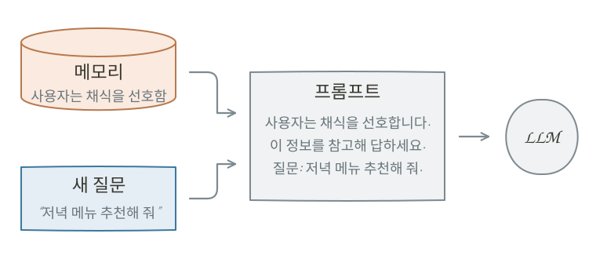
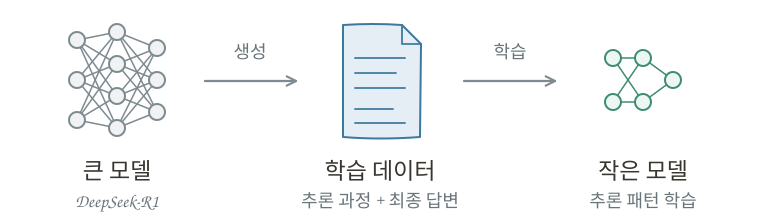
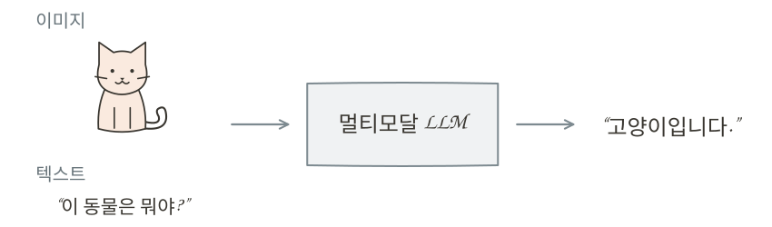

# 오늘날의 LLM {#modern-llms}

LLM은 등장 이후 빠르게 발전하며 그 능력과 활용 범위를 넓혀 왔습니다. 단순히 질문에 답하거나 글을 생성하는 것을 넘어, 더욱 복잡한 문제를 해결하고 다양한 상황에서 활용할 수 있도록 발전하고 있습니다. 이러한 변화는 모델 자체의 성능 향상뿐만 아니라, LLM을 더욱 편리하고 개인화된 방식으로 활용하는 데에서도 나타납니다.

이 장에서는 **오늘날 LLM의 주요 특징과 기술적 발전**을 살펴보겠습니다.

## LLM에 입력한 정보는 어디로 갈까? {#memory}

LLM과 대화하다 보면 이전에 이야기했던 내용이나 사용자의 취향을 기억하고, 이를 바탕으로 답변하는 모습을 볼 수 있습니다. 이러한 기능을 **메모리(Memory)**라고 합니다. 메모리는 사용자의 선호도나 중요한 정보를 저장해 두었다가 이후 대화에서 활용함으로써, 더욱 개인화되고 일관된 답변을 제공하기 위해 사용됩니다.

메모리는 이전 대화에서 얻은 정보를 활용해 새로운 대화에서도 맥락(Context)을 제공하는 방법 중 하나입니다. 일반적으로 LLM 자체가 과거의 모든 대화를 기억하는 것은 아니며, 서비스가 필요한 정보를 별도로 저장해 두었다가 새로운 질문이 들어오면 관련 정보를 프롬프트에 포함해 모델에 전달하는 방식으로 구현합니다.

{ .neural-network-image }

여기서 중요한 점은 **메모리와 모델 학습은 서로 다른 과정**이라는 것입니다. 모델의 학습은 데이터를 이용해 가중치를 조정하는 과정인 반면, 메모리는 저장된 정보를 필요할 때 모델에 제공하는 방식입니다. 따라서 사용자의 이름이나 취향을 기억하더라도 대화 중에 모델의 가중치가 실시간으로 변경되는 것은 아닙니다.

한편 사용자가 입력한 데이터가 어떻게 저장되고 활용되는지는 별개의 문제입니다. 서비스에 따라 입력한 내용이 대화 기록이나 메모리로 저장될 수 있으며, 일부 서비스에서는 수집된 데이터를 향후 모델의 학습이나 성능 개선에 활용하기도 합니다. 이러한 데이터 활용 여부는 서비스의 정책과 사용자의 설정에 따라 달라집니다.

따라서 LLM을 사용할 때는 **개인정보나 민감한 정보를 함부로 입력하지 않도록 주의**해야 합니다. 특히 주민등록번호, 비밀번호, 금융 정보와 같은 개인정보뿐만 아니라 외부에 공개해서는 안 되는 회사 내부 자료도 신중하게 다뤄야 합니다.

## 단계적으로 생각하기 {#chain-of-thought}

LLM의 발전은 더 많은 지식을 학습하는 것뿐만 아니라, 복잡한 문제를 어떻게 해결할 것인가라는 방향으로도 이어졌습니다. 단순한 질문에는 바로 답할 수 있지만, 수학이나 코딩처럼 여러 단계의 판단이 필요한 문제에서는 풀이 과정을 단계적으로 살펴보는 것이 도움이 될 수 있습니다.

이러한 아이디어를 활용한 대표적인 방법이 **Chain-of-Thought(CoT)**입니다. CoT는 모델이 최종 답을 바로 생성하는 대신, 문제를 해결하는 **중간 추론 과정을 단계적으로 생성하도록 유도하는 프롬프팅 기법**입니다.

예를 들어, 2022년 Google 연구진이 발표한 CoT 논문에서는 다음과 같은 문제를 사용했습니다.

> 로저는 테니스공 5개를 가지고 있습니다. 그는 테니스공이 3개씩 들어 있는 캔을 2개 더 샀습니다. 로저는 이제 테니스공을 몇 개 가지고 있을까요?

이처럼 여러 계산 단계를 거쳐야 하는 문제는 당시의 LLM이 최종 답을 바로 생성하도록 했을 때 틀리는 경우가 있었습니다.

CoT에서는 모델이 이러한 문제를 단계적으로 풀도록 유도하기 위해, **문제와 정답뿐만 아니라 중간 풀이 과정까지 포함한 예시 프롬프트를 제공**합니다. 예를 들어 위 문제에 다음과 같은 풀이 과정을 함께 보여주는 방식입니다.

> 로저는 처음에 테니스공 5개를 가지고 있습니다.  
> 캔 하나에는 3개의 공이 있고, 2개의 캔을 샀으므로 6개의 공을 더 가지게 됩니다.  
> 따라서 5 + 6 = 11개입니다.  
> **정답은 11개입니다.**

이처럼 중간 풀이 과정이 포함된 예시를 제공하면, 모델은 새로운 문제에서도 정답만 바로 생성하는 대신 계산이나 논리적 추론 과정을 단계적으로 생성한 뒤 최종 답을 도출할 수 있습니다.

실제로 CoT는 여러 단계의 계산이나 논리적 판단이 필요한 문제에서 모델의 추론 성능을 크게 향상시킬 수 있음을 보여주었습니다.

## DeepSeek 쇼크 {#deepseek-shock}

2025년 1월 중국의 AI 기업 DeepSeek가 공개한 **DeepSeek-R1**은 전 세계 AI 업계에 큰 충격을 주었습니다. 특히 높은 추론 성능을 비교적 효율적으로 구현했다는 점이 주목받으며, 고성능 AI 모델 개발에 반드시 막대한 비용이 필요한가라는 논쟁을 불러일으켰습니다.

이러한 충격은 주식 시장에도 영향을 미쳤습니다. 고성능 AI 개발에 필요한 반도체와 데이터센터 투자가 예상보다 줄어들 수 있다는 우려가 확산되면서, 2025년 1월 27일 NVIDIA의 주가는 하루 만에 약 17% 하락했습니다. 시가총액으로는 약 6,000억 달러가 사라지며 당시 미국 기업 역사상 가장 큰 하루 시가총액 감소를 기록했습니다.

### 추론 모델 {#reasoning-model}

DeepSeek-R1이 주목받은 이유는 비용뿐만이 아니었습니다. 추론 모델의 발전에도 중요한 가능성을 보여주었기 때문입니다.

앞서 살펴본 CoT는 프롬프트를 통해 모델이 단계적인 추론 과정을 생성하도록 유도하는 방법이었습니다. 이후에는 학습을 통해 모델의 추론 능력 자체를 향상시키는 기술이 발전했고, 이를 활용한 **추론 모델(Reasoning Model)**이 등장했습니다. 추론 모델은 복잡한 문제를 해결하기 위해 여러 단계의 추론 과정을 생성하도록 학습된 모델입니다.

DeepSeek 연구진은 R1 개발 과정에서 **DeepSeek-R1-Zero**라는 실험적 모델도 공개했습니다. 이 모델은 사람이 작성한 추론 과정을 미리 학습시키지 않고, 문제의 정답 여부와 출력 형식 등에 따라 보상을 주는 **강화학습(Reinforcement Learning)**만으로도 추론 능력을 발전시킬 수 있음을 보여주었습니다.

강화학습 자체는 이전의 LLM에서도 사용되던 방법입니다. 앞서 살펴본 [RLHF](11-gpt.md/#chatgpt)에서는 사람이 여러 답변을 비교해 어떤 답변을 더 선호하는지 평가하고, 이를 바탕으로 보상 모델을 학습시켰습니다. 이후 LLM은 이 보상 모델로부터 높은 점수를 받도록 학습됩니다. 주된 목적은 모델의 답변을 사람의 의도와 선호에 맞게 조정하는 것이었습니다.

R1-Zero는 이와 다른 방식으로 강화학습을 활용했습니다. 수학이나 코딩처럼 정답을 비교적 명확하게 확인할 수 있는 문제를 풀게 하고, 최종 답이 맞는지 등을 기준으로 보상을 주었습니다. 사람이 각각의 추론 과정을 직접 평가하거나 모범 풀이를 미리 학습시키지 않아도, 모델이 시행착오를 거치며 문제 해결 능력을 발전시키도록 한 것입니다.

기존 RLHF가 주로 “사람이 선호하는 답변인가?”를 기준으로 모델을 학습시켰다면, R1-Zero는 “문제를 실제로 맞혔는가?”라는 검증 가능한 결과를 중심으로 학습했습니다. 그 과정에서 문제를 여러 단계로 나누어 풀거나 자신의 풀이를 다시 검토하는 등의 추론 행동이 자연스럽게 나타났습니다.

!!! info "두 가지 의미의 추론"

    Inference와 Reasoning은 한국어로는 모두 ‘추론’이라고 번역하지만, 두 단어가 가리키는 대상은 다릅니다.

    - **Inference**는 [앞 장에서 살펴본](13-after-pretraining.md#inference) 것처럼, 학습이 끝난 모델에 새로운 입력을 넣어 결과를 얻는 실행 과정입니다. 간단한 답변을 생성하든 여러 단계의 Reasoning을 거치든, 모델이 실제로 실행되어 결과를 만들어내는 과정 전체를 의미합니다.
    - **Reasoning**은 문제를 해결하기 위해 중간 단계의 계산이나 논리적 판단을 거치는 방식입니다. 앞서 살펴본 CoT와 추론 모델에서 말하는 ‘추론’이 여기에 해당합니다.

    쉽게 말해, Inference는 **학습된 모델을 실행해 결과를 얻는 과정**이고, Reasoning은 **답에 도달하기 위해 생각하는 과정**입니다.

### 증류 {#distillation}

DeepSeek는 추론 능력을 더 작은 모델에 전달하기 위해 **증류(Distillation)**라는 기존의 학습 기법도 활용했습니다. 증류는 원래 막걸리와 같은 술을 가열해 알코올 성분을 분리하고 농축하여 증류식 소주를 만드는 것처럼, 혼합물에서 원하는 성분을 분리하는 과정을 의미합니다. AI에서는 이 이름을 빌려 **큰 모델이 가진 능력을 작은 모델에 전달하는 학습 방법**을 증류라고 부릅니다.

DeepSeek는 R1이 다양한 문제를 풀면서 생성한 추론 과정과 최종 답변을 학습 데이터로 활용해 더 작은 모델을 학습시켰습니다. 작은 모델은 이러한 데이터를 학습하면서 문제를 여러 단계로 나누어 풀고, 답에 도달하는 추론 패턴을 자신의 가중치에 반영하게 됩니다.

{ .neural-network-image }

이는 큰 모델의 모든 지식을 그대로 복사하는 것이 아닙니다. **큰 모델이 생성한 데이터를 통해 문제 해결에 유용한 패턴을 작은 모델이 학습하도록 하는 것**입니다. DeepSeek는 이를 통해 상대적으로 작은 모델에서도 높은 수준의 추론 성능을 구현할 수 있음을 보여주었습니다.

## 텍스트를 넘어서 {#multi-modal}

지금까지 살펴본 LLM은 주로 텍스트를 입력받아 텍스트를 생성하는 모델이었습니다. 하지만 오늘날의 LLM은 글을 읽고 쓰는 것을 넘어 이미지나 음성, 영상 등 다양한 형태의 정보도 처리할 수 있도록 발전하고 있습니다. 이러한 기술을 **멀티모달(Multimodal)**이라고 합니다.

여기서 모달리티(Modality)란 정보를 표현하는 형태를 의미합니다. 텍스트, 이미지, 음성은 각각 서로 다른 모달리티입니다. 멀티모달 AI는 이처럼 서로 다른 형태의 정보를 함께 처리할 수 있는 인공지능을 말합니다.

예를 들어 사용자가 고양이 사진을 보여주며 "이 동물은 뭐야?"라고 질문하면, 멀티모달 LLM은 이미지 속 동물을 파악하고 질문과 연결해 "고양이입니다."라고 답할 수 있습니다. 외국어로 말하는 사람의 음성을 듣고 내용을 이해하거나, 영상 속 장면에 대한 질문에 답하는 것도 멀티모달 기술의 활용 사례입니다.

{ .neural-network-image }

그렇다면 LLM은 어떻게 이미지나 음성을 이해할 수 있을까요? 기본적인 원리는 **서로 다른 형태의 정보를 벡터로 변환해 LLM이 함께 처리할 수 있도록 하는 것**입니다.

텍스트는 앞서 살펴본 것처럼 토큰으로 나눈 뒤 임베딩 벡터로 변환합니다. 이미지나 음성 역시 각각의 특성을 추출하는 과정을 거쳐 벡터로 표현합니다. 다만 서로 다른 방식으로 만들어진 벡터는 차원이나 표현 방식이 다를 수 있으므로, 이를 LLM이 처리할 수 있는 형태로 변환하는 과정이 필요합니다.

이렇게 변환된 벡터들을 LLM에 함께 전달하면, 모델은 이미지 속 정보와 텍스트 질문의 관계를 파악해 답변을 생성할 수 있습니다. 물론 구체적인 구현 방식은 모델마다 다릅니다.

멀티모달 기술의 발전으로 LLM은 텍스트만 다루는 도구에서 벗어나, 사람이 보고 듣는 다양한 정보를 활용해 상호작용하는 AI로 발전하고 있습니다.

## :material-pencil: 실습 과제 {#exercises}

다음 문장이 맞으면 O, 틀리면 X를 선택하세요.

1. 메모리 기능으로 사용자의 취향을 기억하려면, 대화할 때마다 모델의 가중치를 변경해야 한다.
2. CoT는 모델이 최종 답만 바로 생성하도록 유도하는 프롬프팅 기법이다.
3. Reasoning은 문제 해결을 위한 단계적인 판단을 뜻하고, Inference는 학습된 모델을 실행해 결과를 얻는 과정을 뜻한다.
4. 증류는 큰 모델이 생성한 답변이나 추론 데이터를 활용해 작은 모델을 학습시키는 방법이다.
5. 멀티모달 LLM은 이미지와 텍스트처럼 서로 다른 형태의 정보를 함께 처리할 수 있다.

??? success "정답·해설"
    1. **X** — 메모리는 서비스가 별도로 저장한 정보를 필요할 때 모델의 입력으로 제공하는 방식이며, 이를 위해 모델의 가중치를 변경할 필요는 없습니다.
    2. **X** — 중간 계산이나 논리적 판단을 단계적으로 생성하도록 유도하는 방법입니다.
    3. **O** — Reasoning은 답에 도달하기 위한 추론 방식이고, Inference는 학습된 모델로 입력을 처리하는 실행 과정입니다.
    4. **O** — 큰 모델이 만든 데이터를 학습에 활용해, 작은 모델에도 문제 해결에 유용한 패턴을 전달할 수 있습니다.
    5. **O** — 이미지 속 내용을 텍스트 질문과 연결해 답하는 것처럼, 여러 형태의 정보를 함께 활용할 수 있습니다.
